

  

  
  
  
  
  

  <a href="https://github.com/jagwey/THE-ROOM-REMEMBERS-release/releases/latest"><strong>📥 Android APK İndir</strong></a>
  &nbsp;·&nbsp;
  <a href="#-neden-farklı"><strong>⚔️ Öne Çıkanlar</strong></a>
  &nbsp;·&nbsp;
  <a href="#-dünyadan-kareler"><strong>🖼️ Galeri</strong></a>
  &nbsp;·&nbsp;
  <a href="#-kontroller"><strong>🎮 Kontroller</strong></a>

 

  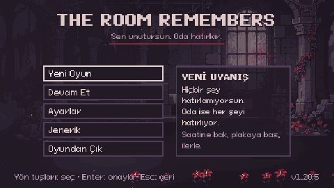
   
  <em>Gerçek oyun içi kayıt · Canlı paralaks, kılıç komboları, atılma ve karanlık gotik odalar</em>

  

## 🕯️ Uyanıyorsun. Adın Yok. Duvarlar Seni Tanıyor.

> *"Soğuk taş zemin, durmuş bir saat, karanlıkta parlayan kızıl çiçekler… Her ölümde hafızan silinir; ama **oda hiçbir şeyi unutmaz**."*

**THE ROOM REMEMBERS**, ölümün bir ceza değil, **dünyayı değiştiren bir bulmaca aracına** dönüştüğü karanlık gotik bir 2D aksiyon-gizem oyunudur.

Kendini zamandan kopmuş, dışarıya açılan hiçbir kapısı olmayan devasa bir yeraltı tesisinde bulursun. **Altı farklı bölge** ve **47 bağlantılı oda** boyunca geçmişinin parçalarını toplar, kilitli mühürleri açar ve karanlık koridorlarda seni sessizce izleyen figürün niyetini çözmeye çalışırsın.

---

## ⚔️ Neden Farklı?

<table>
  <tr>
    <td width="52%" valign="middle">
      <h3>💀 Ölüm Bir Araçtır &amp; Kendi Yankınla Oyna</h3>
      <ul>
        <li><strong>Geçmiş Bedenlerin Kalır:</strong> Düştüğün yerde bedenin kaybolmaz — basamak olur, mekanizmaları çalıştırır, karanlıkta yolunu aydınlatır.</li>
        <li><strong>Yankı Mekaniği:</strong> Birkaç saniyelik hareketini kaydet; kendi gölgenle eşzamanlı hareket ederek tek başına aşılamayacak kapıları aç.</li>
        <li><strong>Lanet ve Denge:</strong> Her hamle bir bedel taşır. Lanet yükselirken kontrolü kaybetmeden mühür noktalarında nefes al.</li>
      </ul>
    </td>
    <td width="48%" align="center" valign="middle">
      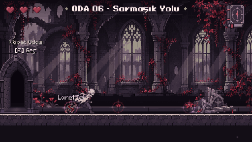
    </td>
  </tr>
  <tr>
    <td width="48%" align="center" valign="middle">
      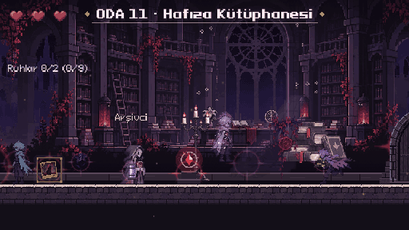
    </td>
    <td width="52%" valign="middle">
      <h3>🗡️ Akıcı Aksiyon &amp; Gizemli Keşif</h3>
      <ul>
        <li><strong>Çevik Savaş:</strong> 3'lü kılıç kombosu, gölge izli atılma (<em>dash</em>) ve yolculuk boyunca uyanan özel ruh yetenekleri.</li>
        <li><strong>Parçalanmış Ruhlar:</strong> Karanlık odalarda dolaşan tehditlerle yüzleş, düşen ruh kıvılcımlarını yakala.</li>
        <li><strong>Canlı Günlük &amp; Hızlı Seyahat:</strong> Bulduğun her notu, haritayı ve gizli yan odaları tek kitapta takip et; keşfettiğin odalara anında dön.</li>
      </ul>
    </td>
  </tr>
</table>

  

## 🌑 Karanlıkta Kimler Var?

<table>
  <tr>
    <td width="50%" valign="top">
      

        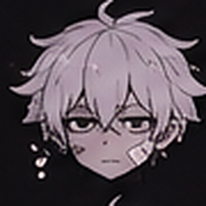
      

      <h4 align="center">Noroi · <em>Unutan Gezgin</em></h4>
      

        Her uyanışta hafızası sıfırlanan ama geride bıraktığı bedenler, izler ve notlarla gerçeğe yürüyen kahraman.
      

    </td>
    <td width="50%" valign="top">
      

        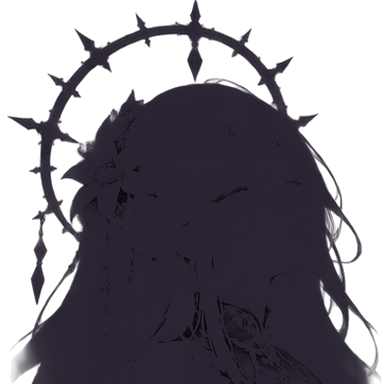
      

      <h4 align="center">??? · <em>Odanın Sessiz Bekçisi</em></h4>
      

        Koridorların gölgesinden seni izler; düşen bedenlerinin başında durup kızıl çiçekler bırakır. Dost mu, yoksa bir gardiyan mı?
      

    </td>
  </tr>
</table>

  

## 🖼️ Dünyadan Kareler

> *Spoiler içermez — altı bölgenin atmosferinden ve arayüzünden seçilmiş güncel kareler.*

  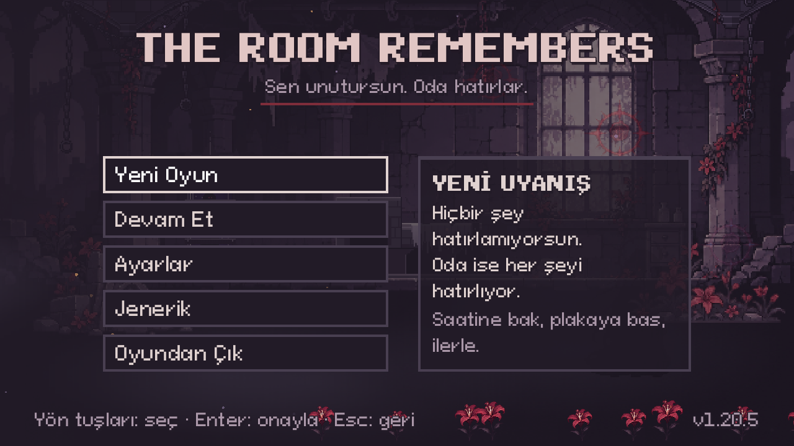
  &nbsp;
  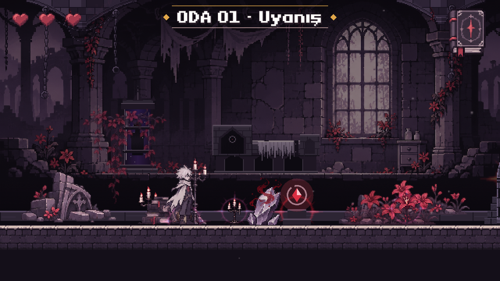
   
  Canlı paralaks ana menü &nbsp;·&nbsp; Uyanış Odası — yolculuğun ilk adımı

  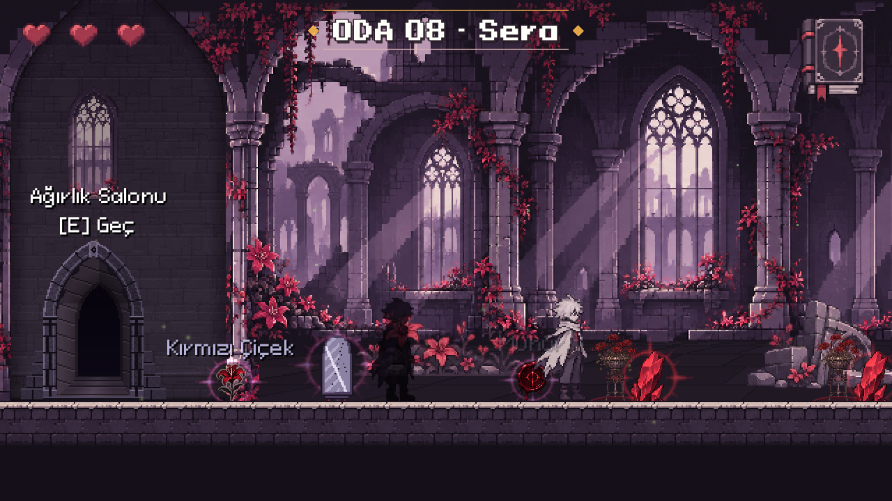
  &nbsp;
  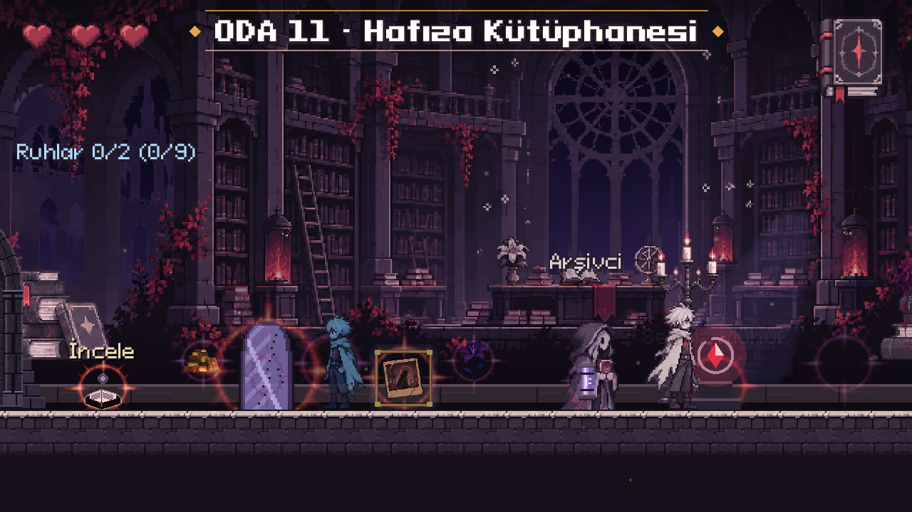
   
  Çürüme Bahçesi — kızıl çiçekler ve taş kemerler &nbsp;·&nbsp; Hafıza Kütüphanesi — mum ışığı ve gölgeler

  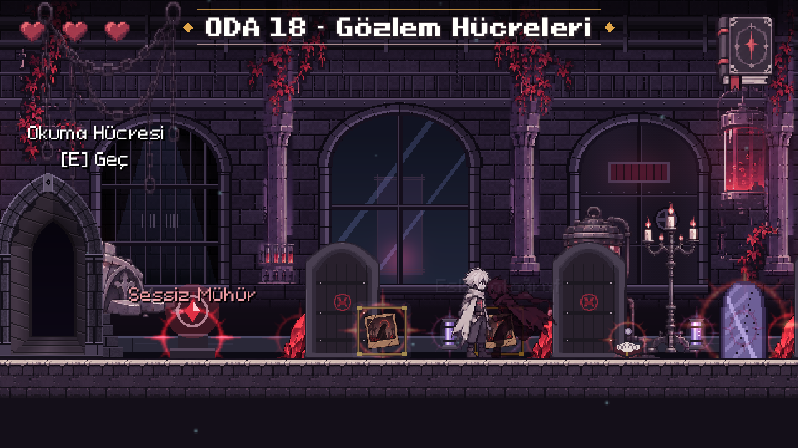
  &nbsp;
  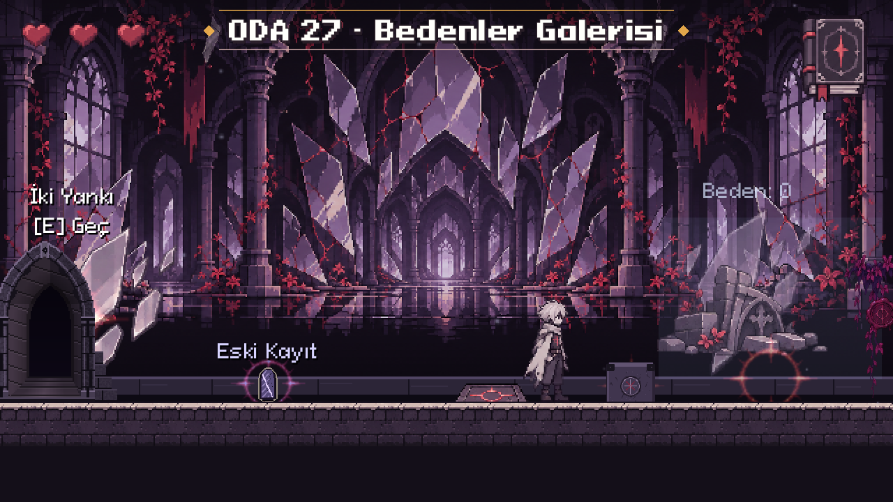
   
  Kara Deney Mahzeni — sessiz hücreler &nbsp;·&nbsp; Aynalar Salonu — kırık yansımalar

  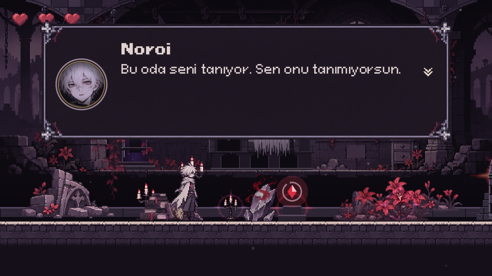
  &nbsp;
  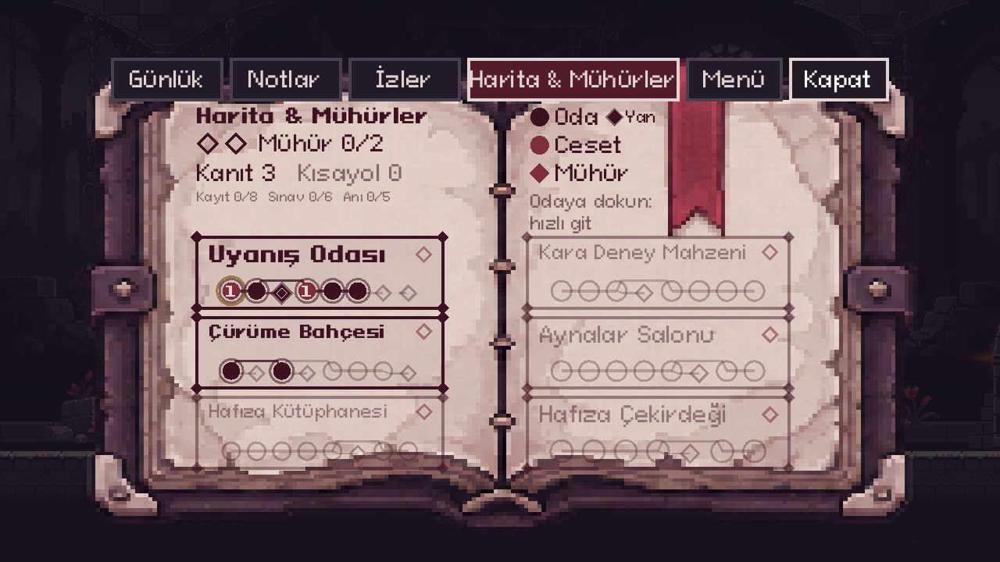
   
  Portreli diyalog atmosferi &nbsp;·&nbsp; Canlı günlük, harita ve tek dokunuşla hızlı seyahat

  

## 📥 İndirme ve Kurulum

| Platform | Durum | Nasıl Oynanır? |
| :--- | :---: | :--- |
| **Android (`arm64`)** | ✅ Hazır | **[Son APK'yı İndir](https://github.com/jagwey/THE-ROOM-REMEMBERS-release/releases/latest)** → Dosyayı telefonda açıp yükle. Oyun içi güncelleme kontrolü yeni sürüm çıktığında başlık ekranında haber verir. |
| **PC (Windows / Linux / macOS)** | ✅ Hazır | Godot **4.7.2** ile projeyi açıp **F5** ile doğrudan oyna. |

> **Tamamen ücretsiz · Reklamsız · Hesap gerektirmez · Çevrimdışı oynanabilir.**

---

## 🎮 Kontroller

Android'de ilk açılışta **Sabit Joystick**, **Yüzen Joystick** veya **Yön Tuşları** arasından seçim yapabilir; buton boyutunu, titreşim şiddetini ve yazı boyutunu dilediğin zaman **Günlük → Menü → Ayarlar** ekranından değiştirebilirsin.

| Eylem | Klavye (PC) | Android (Dokunmatik) |
| :--- | :--- | :--- |
| **Hareket** | `A / D` veya `← / →` | Joystick veya Yön Tuşları |
| **Zıpla** | `W`, `Space` veya `↑` | **Zıpla** butonu *(isteğe bağlı joystick yukarı)* |
| **Kılıç Kombosu** | `Z` veya `J` | **Kılıç** butonuna dokun |
| **Atılma (Dash)** | `X` veya `K` | Ekranda hızlıca **kaydır** |
| **Etkileş / Konuş** | `E` veya `F` | Nesneye / kişiye **dokun** ya da alttaki **el simgeli hedef çipine** dokun |
| **Özel Yetenek** | `Q` veya `C` | **Kılıç** butonunu **basılı tut** |
| **Günlük, Harita & Menü** | `I`, `Tab` veya `Esc` | Sağ Üst **Kitap** ikonu / Geri tuşu |

> Bir nesne veya Noroi dokunmatik tuşların arkasında kalırsa tuşlar otomatik olarak saydamlaşır; uzaktaki bir nesneye dokunursan *"Yaklaşmalıyım"* uyarısı çıkar.

---

🛠️ Geliştirici Bilgisi &amp; Teknik Özet (Godot 4.7.2)

* **Motor:** Godot `4.7.2` (`GL Compatibility`, `640×360` piksel-hizalı görünüm, `1280×720` pencere / Android `arm64`)
* **Ana Sahne:** `scenes/main/main.tscn` (`F5` ile başlar)
* **Otomatik Doğrulama:** `docs/gelistirme/Run-Audit.ps1` (headless E2E, oda grafiği, kayıt sağlamlığı ve mobil yerleşim denetimleri)
* **Geliştirme Günlüğü &amp; Ayrıntılı Notlar:** Tüm teknik mimari, sürüm geçmişi ve görev kayıtları `PROGRESS.md` dosyasında tutulur.
* **Resmî APK Dağıtımı:** [`jagwey/THE-ROOM-REMEMBERS-release`](https://github.com/jagwey/THE-ROOM-REMEMBERS-release/releases)

  

  <strong>THE ROOM REMEMBERS</strong> · © TORIMON — Tüm hakları saklıdır. 
  <em>Sen unutursun. Oda hatırlar. · You forget. It remembers.</em>

