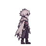
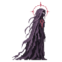
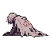
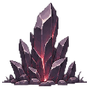
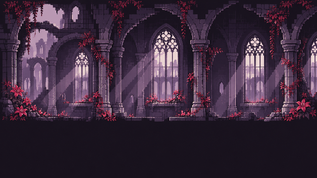
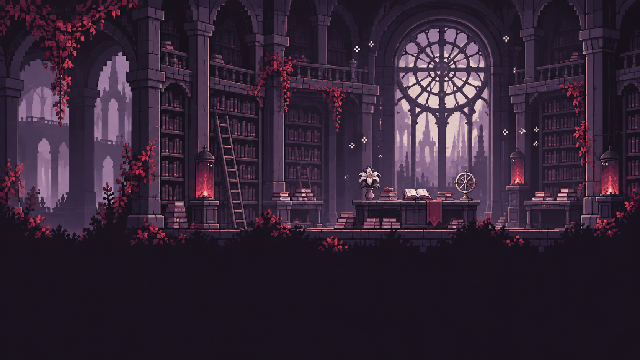
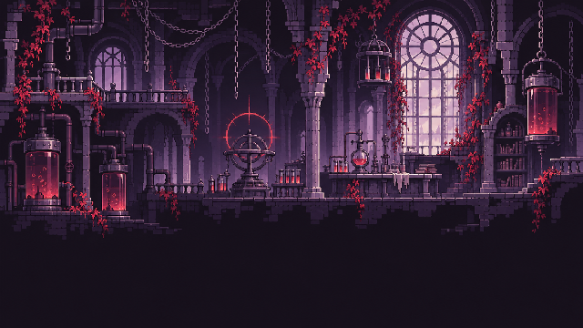
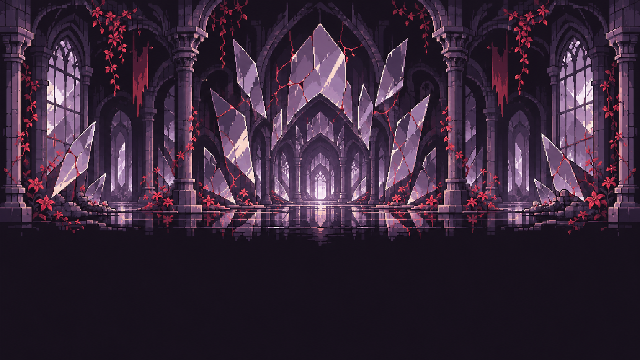
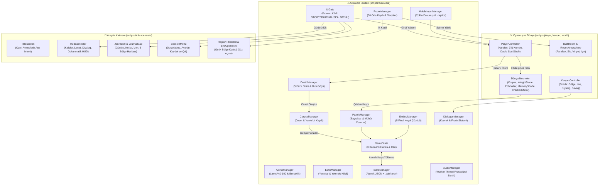

# THE ROOM REMEMBERS

<p align="center">
  
  &nbsp;&nbsp;&nbsp;
  
</p>

<h3 align="center">
  <strong>Sen unutursun. O hatırlar.</strong><br/>
  <em>You forget. It remembers.</em>
</h3>

<p align="center">
  <strong>TORIMON</strong> · Gotik Psikolojik Aksiyon-Bulmaca &amp; Hafıza Platform Oyunu · Godot 4.7 · Android &amp; PC
</p>

<p align="center">
  <a href="https://github.com/jagwey/THE-ROOM-REMEMBERS-release/releases/tag/v1.4.8"></a>
  <a href="https://github.com/jagwey/THE-ROOM-REMEMBERS/releases"></a>
  <a href="https://godotengine.org/"></a>
  
</p>

---

<p align="center">
  
</p>

## 📖 Oyun Hakkında

> *"Gözlerin aralanır. Taş soğuk, tavan yüksek, adın yabancı. Sen öldüğünde hafızan sıfırlanır — fakat oda bıraktığın her bedeni, kırdığın her mührü ve verdiğin her sözü hatırlar."*

**THE ROOM REMEMBERS**, ölümün bir başarısızlık değil, **dünyayı değiştiren fiziksel ve anlatısal bir araç** olduğu karanlık gotik bir 2D aksiyon-bulmaca oyunudur.

Oyuncu **Shiren** olarak ne adını ne de neden bu yıkık tesiste tutulduğunu bilerek uyanır. Her ölümde Shiren'in o yaşamdaki belleği silinir ve ilk yatağında yeniden gözlerini açar; ancak **oda hiçbir şeyi unutmaz**. Önceki yaşamlarından kalan kendi cansız bedenlerin odalarda fiziksel olarak kalmaya devam eder: üzerlerine basıp yüksek çıkıntılara zıplayabilir, onları ağır basınç plakalarının üstüne itebilir, son 3 saniyelik mor **Yankı Tekrarlarını (Echo Replay)** izleyerek ölüm anındaki sırları çözebilir ve **Bekçi Shilda**'nın bedenlerine bıraktığı kızıl ölüm çiçeklerinin ışığıyla karanlıkta gizlenen sembolleri ortaya çıkarabilirsin.

<p align="center">
  
</p>

---

## 📦 Aktif Sürümler ve İndirme Bağlantıları (GitHub Releases)

Depodaki tüm derlenmiş Android (`arm64-v8a`) APK sürümleri aktif olarak **[GitHub Releases](https://github.com/jagwey/THE-ROOM-REMEMBERS/releases)** sayfasında sunulmaktadır.

> **Önerilen Güncel Sürüm:** [**v1.4.8 (`TheRoomRemembers-1.4.8-android-arm64.apk`)**](https://github.com/jagwey/THE-ROOM-REMEMBERS-release/releases/tag/v1.4.8) — Gözlem Balkonu mühür sıkışması düzeltildi; v1.4.7 ölüm sonrası dokunmatik düğme düzeltmesini içerir.

| Sürüm | Durum | APK Dosyası / İndirme | Öne Çıkan Yenilikler ve Kapsam |
| :--- | :---: | :--- | :--- |
| **[v1.4.8](https://github.com/jagwey/THE-ROOM-REMEMBERS-release/releases/tag/v1.4.8)** | 🟢 **Güncel (Latest)** | [📥 `TheRoomRemembers-1.4.8-android-arm64.apk`](https://github.com/jagwey/THE-ROOM-REMEMBERS-release/releases/tag/v1.4.8) | Gözlem Balkonu (Oda 02) sıkışması düzeltildi: mahzen yolundan gelince mor mühür arkadan açılıyor, Ruh Kesimi olmadan da çıkılabiliyor (`versionCode 26`). |
| **[v1.4.7](https://github.com/jagwey/THE-ROOM-REMEMBERS-release/releases/tag/v1.4.7)** | Önceki | [📥 `TheRoomRemembers-1.4.7-android-arm64.apk`](https://github.com/jagwey/THE-ROOM-REMEMBERS-release/releases/tag/v1.4.7) | Ölüm/diriliş sonrası kaybolan dokunmatik düğmeler (joystick, zıplama, saldırı) düzeltildi; ölümde basılı kalan girdiler temizleniyor (`versionCode 25`). |
| **[v1.4.6](https://github.com/jagwey/THE-ROOM-REMEMBERS-release/releases/tag/v1.4.6)** | Önceki | [📥 `TheRoomRemembers-1.4.6-android-arm64.apk`](https://github.com/jagwey/THE-ROOM-REMEMBERS-release/releases/tag/v1.4.6) | Beden taşıma yeniden (köprü/boşluk geçişi, Kemik Mahzeni kodu), Ruh Kesişi gerektirmeyen metin/gölge düzeltmeleri, Shilda adı, oda etkileşim aralıkları, HUD/harita/pad kırpılma düzeltmeleri (`versionCode 24`). |
| **[v1.4.5](https://github.com/jagwey/THE-ROOM-REMEMBERS-release/releases/tag/v1.4.5)** | Önceki | [📥 `TheRoomRemembers-1.4.5-android-arm64.apk`](https://github.com/jagwey/THE-ROOM-REMEMBERS-release/releases/tag/v1.4.5) | Konuşmacı sözleşmesi ve isim açılışı, diyalog çerçeveleri, HUD/bölge kartı çakışma düzeltmeleri, gotik kapılar ve yeni nesneler, çatlak duvar/Devam Et düzeltmeleri, oyun içi güncelleme (`versionCode 23`). |
| **[v1.3.0](https://github.com/jagwey/THE-ROOM-REMEMBERS/releases/tag/v1.3.0)** | 🔵 Kararlı | [📥 `TheRoomRemembers-1.3.0.apk`](https://github.com/jagwey/THE-ROOM-REMEMBERS/releases/download/v1.3.0/TheRoomRemembers-1.3.0.apk) | **M1–M3 Tam Sürüm:** Yürüyen & Kalkanlı Bellek Gölgeleri (`Memory Shades`), ceset üstü platform mekaniği, `EchoTwin` savaş kaydı, Bölge Başlık Kartları, Çatlak Ayna hızlı seyahat, mobil haptics, gotik kapı katmanlama ve ses iş parçacığı düzeltmeleri (`versionCode 17`). |
| **[v1.2.0](https://github.com/jagwey/THE-ROOM-REMEMBERS/releases/tag/v1.2.0)** | 🔵 Kararlı | [📥 `TheRoomRemembers-1.2.0-android-arm64.apk`](https://github.com/jagwey/THE-ROOM-REMEMBERS/releases/tag/v1.2.0) | **V4.1 Güncellemesi:** Katmanlı gotik kapılar (`96x160`), ortak etkileşim halesi (`InteractGlow`), gelişmiş zıplama fiziği (coyote time, jump buffer, apex hang), doğrulanmış *Kaydet ve Çık / Devam Et* sistemi, yeni kırmızı göz adaptif uygulama ikonu (`versionCode 16`). |
| **[v1.1.0](https://github.com/jagwey/THE-ROOM-REMEMBERS/releases/tag/v1.1.0)** | 🔵 Kararlı | [📥 `TheRoomRemembers-1.1.0-android-arm64.apk`](https://github.com/jagwey/THE-ROOM-REMEMBERS/releases/tag/v1.1.0) | **V3.0 Ölüm & Yeniden Doğuş Sistemi:** Göz açma sinematiği (`EyeOpenIntro`), ruh yükselmesi (`DeathManager` 5 faz), ceset üzerinde son 3 saniyelik mor **Yankı Tekrarı (`EchoReplay`)**, çift kademeli `.bak`/`.prev` kayıt koruma sistemi (`versionCode 15`). |
| **[v1.0.2](https://github.com/jagwey/THE-ROOM-REMEMBERS/releases/tag/v1.0.2)** | ⚪ Arşiv | [📥 `TheRoomRemembers-1.0.2-android-arm64.apk`](https://github.com/jagwey/THE-ROOM-REMEMBERS/releases/tag/v1.0.2) | Atmosferik canlı Ana Menü (`TitleScreen`), kayıt özeti kartı, *Ayarlar* ve *Nasıl Oynanır* panelleri, klavye/gamepad ve dokunmatik menü navigasyonu (`versionCode 14`). |
| **[v1.0.1](https://github.com/jagwey/THE-ROOM-REMEMBERS/releases/tag/v1.0.1)** | ⚪ Arşiv | [📥 `TheRoomRemembers-1.0.1-android-arm64.apk`](https://github.com/jagwey/THE-ROOM-REMEMBERS/releases/tag/v1.0.1) | Oynanış hızı ve zıplama iyileştirmeleri (`175 px/s`), squash-stretch animasyon geçişleri, etkileşim nesnelerine hale (`halo.png`) (`versionCode 13`). |
| **[v1.0.0](https://github.com/jagwey/THE-ROOM-REMEMBERS/releases/tag/v1.0.0)** | ⚪ Arşiv | [📥 `TheRoomRemembers-1.0.0-android-arm64.apk`](https://github.com/jagwey/THE-ROOM-REMEMBERS/releases/tag/v1.0.0) | **8 Fazlı Büyük Yenileme (v1.0 Overhaul):** 30 oda, 6 bölge, `Ruh Kesimi` & `Gölge Atılması` yetenekleri, 4 sekmeli Günlük ve *Harita & Mühürler* görünümü, tam Android dokunmatik HUD (`versionCode 12`). |
| **[v0.10.1](https://github.com/jagwey/THE-ROOM-REMEMBERS/releases/tag/v0.10.1)** | ⚪ Arşiv | [📥 `TheRoomRemembers-0.10.1-android-arm64.apk`](https://github.com/jagwey/THE-ROOM-REMEMBERS/releases/tag/v0.10.1) | Oynanabilir tam hikâye akışı, 18 bağlı oda, görev yönlendirmeleri ve softlock korumaları. |
| **[v0.9.0](https://github.com/jagwey/THE-ROOM-REMEMBERS/releases/tag/v0.9.0)** | ⚪ Arşiv | [📥 `TheRoomRemembers-0.9.0-android-arm64.apk`](https://github.com/jagwey/THE-ROOM-REMEMBERS/releases/tag/v0.9.0) | Genişleme dilimi: Kütüphane, Deney, Aynalar ve Çekirdek bölgelerinin ilk entegrasyonu. |
| **[v0.8.0-debug](https://github.com/jagwey/THE-ROOM-REMEMBERS/releases/tag/v0.8.0-debug)** | ⚪ Prototip | [📥 `TheRoomRemembers-debug.apk`](https://github.com/jagwey/THE-ROOM-REMEMBERS/releases/tag/v0.8.0-debug) | İlk dikey dilim (Vertical Slice) prototipi: Uyanış ve Çekirdek odaları. |

---

## 🕯️ Karakterler, Semboller ve Etkileşim Unsurları

| Görsel | Unsur | Rolü ve Mekanik İşlevi |
| :---: | :--- | :--- |
|  | **Shiren**<br/>*(Oyuncu)* | Her ölümde belleği sıfırlanan fakat bıraktığı izlerle gerçeğe yürüyen ana karakter. 3'lü kılıç kombosu, **Gölge Atılması (`ShadowDash`)** ve **Ruh Kesimi (`SoulSlash`)** yeteneklerini kullanır. |
|  | **Shilda — Bekçi**<br/>*(The Keeper)* | Odanın hafızasını koruyan gizemli figür. Öldüğünde cesedinin başında yas tutar ve bir çiçek bırakır. Ona saldırmak ya da ona güvenmek oyunun sonunu doğrudan belirler. |
|  | **Önceki Bedenler**<br/>*(Corpse & Echo)* | Öldüğün noktada kalan fiziksel bedenin. İlk incelemede son 3 saniyelik mor **Yankı Tekrarını** oynatır; sonrasında **itilebilir ağırlık**, **üzerine çıkılabilir platform** ve **lanet süngeri** görevi görür. |
|  | **Kızıl Ölüm Çiçeği**<br/>*(Mourning Flower)* | Shilda'nın yas tuttuğu bedenlere bıraktığı çiçek. Çiçekli bedenler (**Fener Ceset / Lantern Corpse**) karanlık odaları aydınlatır ve duvarlardaki gizli sembolleri görünür kılar. |
|  | **Durmuş Cep Saati**<br/>*(Pocket Watch)* | Uyanış odasındaki ilk kanıt. Kapağının içindeki kazıntı ve durduğu saat (`3:14`), hem ilk bellek mührünün anahtarıdır hem de Shilda ile olan geçmişin ilk izidir. |
|  | **Bellek Çekirdeği & Mühürler**<br/>*(Core Crystal)* | Tesisin kalbindeki kristal düzenek. Odalardaki 4 haneli hafıza mühürlerini (`314`, `251`, `418`, `729`) ve iki ana mühür parçasını birleştirerek son seçime ulaşılır. |

---

## ⚙️ Temel Oynanış Mekanikleri

### 1. Üç Katmanlı Hafıza Mimarisi (3-Layer Memory State)
Oyun, her ölümde neyin silinip neyin kalacağını katı bir mimariyle ayırır:
* **🧠 Oyuncu Bilgisi (`player_progress_knowledge` — Kalıcı):** Öğrenilen mühür kodları, toplanan 16 kanıt kartı (`Evidence`), dinlenen yankılar (`Echoes`) ve açılan yetenekler (`SoulSlash`, `ShadowDash`) ölümden etkilenmez.
* **🏛️ Dünya Hafızası (`world_memory_state` — Kalıcı):** Önceki yaşamların cesetleri ve koordinatları, çözülmüş ağırlık/kapı bulmacaları, keşfedilmiş bölgeler ve Shilda ile olan güven/savaş durumu dünyada kalıcı olarak iz bırakır.
* **🩸 Karakterin Mevcut Yaşamı (`character_current_life_knowledge` — Geçici):** O anki bedenin geçici etkileşimleri, anlık diyalog bayrakları ve kontrol noktası ölümle birlikte sıfırlanır.

### 2. Ceset Fizikleri, Yankı İkizi (`EchoTwin`) ve Çevresel Bulmacalar
* **Çok Amaçlı Fiziksel Cesetler:** Her odada en fazla 3 kalıcı beden tutulur (plaka üzerinde aktif ağırlık tutan `anchoring` bedenler asla silinmez). Bedenler `36px` adımlarla basınç plakalarına itilebilir, tek yönlü üst çarpışması (`one_way_collision`) sayesinde yüksek platformlara zıplamak için basamak olarak kullanılabilir ve zehirli **Lanet Bulutlarını (`CurseCloud`)** emerek yolu temizler.
* **Yankı Sunağı ve Gölge İkizi (`EchoAltar` & `EchoTwin`):** Sunak etkinleştirildiğinde oyuncunun **yürüyüşü, zıplaması, etkileşimi, kılıç saldırısı ve Ruh Kesimi yeteneği** zaman damgalı olarak kaydedilir. Kayıt bittiğinde doğan mor **Yankı İkizi**, oyuncunun hareketlerini birebir tekrarlayarak eşzamanlı iki şalterli kapıları ve zamanlamalı devreleri açar.

### 3. Savaş Sistemi, Yetenekler ve Lanet / Berraklık Dengesi
* **3'lü Kılıç Kombosu & Hitstop:** Yakın dövüş saldırıları kıvılcım, ekran sarsıntısı ve mikro-hitstop ile desteklenir. 3. kombo darbesiyle (`finisher`) yok edilen **Yürüyen Bellek Gölgeleri (`Walking Memory Shade`)**, oyuncunun lanetini **%10 temizleyen Berraklık Zerresi (`Memory Mote`)** düşürür.
* **Kalkanlı Bellek Gölgeleri (`Shielded Memory Shade`):** Önden gelen normal kılıç darbelerini geri yansıtır. Kalkanlarını kırmak için **Ruh Kesimi (`SoulSlash`)** dalgası göndermek veya **Gölge Atılması (`ShadowDash`)** ile içlerinden geçip arkalarından vurmak gerekir.
* **Lanet Sayacı (`CurseManager`):** Lanetli dikenler, bulutlar ve mühürler oyuncunun lanet oranını artırır. Lanet **%80**'i geçtiğinde ekran vinyeti daralır ve harekette istemsiz kaymalar (`curse drift`) başlar; **%100** olduğunda beden lanet tarafından ele geçirilir (`Possession` — ceset bırakmadan yeniden doğuş veya Çekirdek'te *Lanet Ele Geçirmesi* finali).

<p align="center">
  
  &nbsp;&nbsp;
  
</p>

---

## 🗺️ Dünya Atlası: 6 Ana Bölge ve 30 Bağlı Oda

Oyun dünyası, birbirine ana koridorlar, mühürlü kapılar, yan odalar ve **Çatlak Ayna (`Cracked Mirror`)** hızlı seyahat noktalarıyla bağlı **6 atmosferik bölge** ve **30 sahneden** oluşur:

| Bölge | Görsel Atmosfer | Odalar ve Temel Bulmacalar |
| :--- | :---: | :--- |
| **I. UYANIŞ MAHMUZU**<br/>*(`awakening`)* |  | **Odalar:** `Uyanış`, `Gözlem Balkonu`, `İlk Bedenler Mahzeni`, `Kırık Geçit`, `Mühürlü Eşik`<br/>**Odak:** Cep saati (`314`), ilk basınç plakası, Shilda ile ilk karşılaşma, kırmızı yarıklardan kaçış ve ilk bellek mührü. |
| **II. ÇÜRÜME BAHÇESİ**<br/>*(`decay`)* |  | **Odalar:** `Sarmaşıklı Koridor`, `Yeraltı Mezarlığı`, `Çürüme Bahçesi`, `Shilda'nın Duvarı`, `Ağırlık Odası`<br/>**Odak:** Kızıl çiçek kanıtları, hibrit taş/ceset ağırlık bulmacaları, sarmaşık kapıları ve Shilda'ya güven seçimi (`trusted_keeper`). |
| **III. HAFIZA KÜTÜPHANESİ**<br/>*(`library`)* |  | **Odalar:** `Kütüphane Girişi`, `Üst Raflar`, `Kayıp Sayfa Odası`, `Yasak Kanat`, `Tanık Odası`<br/>**Odak:** Yırtık sayfa sıralama bulmacası, **Ruh Kesimi (`SoulSlash`)** yeteneğinin kazanılması, `251` mührü ve ilk mühür parçası (`seal_fragment_library`). |
| **IV. YASAK LABORATUVAR**<br/>*(`experiment`)* |  | **Odalar:** `Deney Hücreleri`, `Karantina Koğuşu`, `Yankı Devresi`, `Otorite Kayıt Odası`, `Çekirdek İletkeni`<br/>**Odak:** `EchoAltar` & `EchoTwin` ile eşzamanlı devre bulmacaları, zehirli lanet bulutları, `418` mührü ve deney kayıtları. |
| **V. AYNALAR SALONU**<br/>*(`mirrors`)* |  | **Odalar:** `Ters Yansıma`, `Ayna Labirenti`, `Ayna Tapınağı`, `İkili Ayna`, `Kırılmamış Ayna`<br/>**Odak:** **Gölge Atılması (`ShadowDash`)** yeteneğinin kazanılması, kalkanlı Bellek Gölgeleri, `729` mührü ve ikinci mühür parçası (`seal_fragment_mirrors`). |
| **VI. BELLEK ÇEKİRDEĞİ**<br/>*(`core`)* |  | **Odalar:** `Çekirdek Eşiği`, `Mühür Odası`, `Bellek Mahzeni`, `Çiçeklenme Bahçesi`, `Çekirdek`<br/>**Odak:** İki mühür parçasının birleştirilmesi, geçmişin tam hakikati (`truth_seen`) ve 5 farklı sona açılan son seçim. |

<p align="center">
  
  &nbsp;&nbsp;
  
</p>

<p align="center">
  
</p>

---

## 🎭 Beş Farklı Son (Endings)

`EndingManager` (`scripts/autoload/ending_manager.gd`), oyuncunun oyun boyunca topladığı kanıtlara, Shilda'ya karşı tavrına ve Çekirdek'teki seçimine göre **5 farklı epilog** sunar:

| Son Kodu | Başlık | Tetiklenme Koşulu |
| :--- | :--- | :--- |
| 🌟 **`GOOD`** | **Birlikte Çıkış** | Kütüphane ve Aynalar mühür parçalarını topla (`has_both_seal_fragments()`), gerçeği gör (`truth_seen`), Shilda'ya güven (`trusted_keeper`, ona hiç saldırma) ve Çekirdek'te **Kabul / Birlikte Çık** seçimini yap. |
| 🚶 **`SOLO_EXIT`** | **Yalnız Çıkış** | Çekirdek'te çıkışı seç ancak iki mühür parçasından biri eksik olsun veya Shilda ile güven bağı kurulmamış olsun; Shiren tesisten yalnız çıkar, Shilda içeride kalır. |
| 🏛️ **`WORLD`** | **Yeni Bekçi** | Çekirdek'te **Kal / Nöbeti Devral (`sacrifice`)** seçimini yap; Shilda özgür kalırken Shiren odanın yeni Bekçisi olur. |
| 💥 **`BAD`** | **Çekirdek Çöküşü** | Çekirdek'te Shilda'ya saldır veya Çekirdek Kristalini zorla parçala; döngü şiddetle çöker ve oda sıfırlanır. |
| 🩸 **`CURSE_TAKEOVER`** | **Lanet Ele Geçirmesi** | Çekirdek bölgesindeyken Lanet sayacının **%100**'e ulaşması; lanet Shiren'in bedenini kalıcı olarak ele geçirir. |

---

## 🏗️ Teknik Mimari ve Kod Yapısı

Proje, **Godot 4.7.2 (`GL Compatibility` mobil/masaüstü ortak işleyici)** üzerinde **14 Autoload Singleton** ve veri-güdümlü (data-driven) oda mimarisiyle inşa edilmiştir.

### Sistem Mimarisi Diyagramı



### Klasör ve Dosya Organizasyonu

```text
THE-ROOM-REMEMBERS/
├── project.godot                # Godot 4.7 proje yapılandırması, 14 Autoload, girdi haritası
├── export_presets.cfg           # Android ARM64 APK dışa aktarma profili (com.torimon.theroomremembers)
├── assets/
│   ├── backgrounds/             # 6 bölgenin çok katmanlı parallax arka planları (far, mid, front)
│   ├── characters/              # Shiren, Keeper (Shilda) ve NPC animasyon kareleri & SpriteFrames
│   ├── hud/ & panels/           # Gotik diyalog, günlük, envanter panelleri ve dokunmatik butonlar
│   ├── icon/                    # Android adaptif ikon katmanları ve 192/512px uygulama ikonları
│   ├── layers/ & props/         # Gotik kapılar, mühürler, cep saati, ölüm çiçeği, kristaller
│   └── tiles/                   # Zemin ve duvar piksel-art karo setleri
├── scenes/
│   ├── main/main.tscn           # Kök sahne (WorldRoot, Player, FollowCamera, UI katmanları)
│   ├── rooms/                   # 30 bağlı oda sahnesi (awakening, decay, library, experiment, mirrors, core)
│   ├── player/ & keeper/        # Shiren ve Shilda sahneleri
│   ├── world/                   # Fiziksel ceset, çatlak ayna ve Bellek Gölgesi (Memory Shade) sahneleri
│   └── ui/                      # HUD, Günlük (Journal), Bölge Kartı, Lanet VFX ve Epilog sahneleri
└── scripts/
    ├── autoload/                # 14 küresel sistem yöneticisi (GameState, RoomManager, SaveManager vb.)
    ├── player/                  # player_controller.gd, soul_slash_wave.gd
    ├── keeper/                  # keeper_controller.gd (Shilda AI ve durum makinesi)
    ├── world/                   # 40+ etkileşimli dünya bileşeni (corpse, echo_altar, room_transition vb.)
    ├── story/                   # Bölge görevleri ve hikâye vuruşları (campaign_objectives, shilda_name_beat vb.)
    ├── ui/                      # Başlık ekranı, HUD, Günlük haritası, Mühür tuş takımı, Duraklatma menüsü
    ├── audio/                   # Arka plan iş parçacıklı prosedürel ses sentezleyici (sound_bank, synth_job)
    └── dev/                     # 15+ otomatik Headless QA ve stres testi betiği (release_audit, e2e_runner vb.)
```

---

## 🎮 Kontroller

| Eylem | Masaüstü (Klavye) | Android (Dokunmatik HUD) |
| :--- | :--- | :--- |
| **Hareket** | `A / D`, `Sol / Sağ Ok` | Sol Sanal Joystick (Sabit / Yüzen mod destekli) |
| **Zıplama** | `W`, `Space`, `Yukarı Ok` | Sağ HUD — **Zıpla (`^`)** Butonu *(Coyote + Değişken Yükseklik)* |
| **Saldırı (3'lü Kombo)** | `Z` veya `J` | Sağ Alt — **Kılıç** Butonu |
| **Atılma / Gölge Atılması** | `X` veya `K` | Sağ Alt — **Dash** Butonu |
| **Etkileşim / İtme / Konuşma** | `E` veya `F` | Sağ Orta — **El (`Interact`)** Butonu |
| **Yetenek (Ruh Kesimi)** | `C` veya `L` | Sağ HUD — **Ruh Kesimi (`Skill`)** Butonu |
| **Günlük & Harita** | `I` veya `Tab` | Sağ Üst — **Günlük (Kitap)** İkonu |
| **Duraklatma & Ayarlar** | `Esc` | Sağ Üst — **Menü** Butonu / Android Sistem Geri Tuşu |

---

## 🚀 Kurulum, Çalıştırma ve Otomatik Test Altyapısı

### 1. Android Cihazda Oynama (APK)
1. **[Releases → v1.4.8](https://github.com/jagwey/THE-ROOM-REMEMBERS-release/releases/tag/v1.4.8)** sayfasından `TheRoomRemembers-1.4.8-android-arm64.apk` dosyasını indirin ve telefonunuza kurun.
2. Veya USB hata ayıklaması açık bir Android cihaza `adb` ile doğrudan yükleyin:
   ```powershell
   adb install -r TheRoomRemembers-1.4.8-android-arm64.apk
   adb shell am start -n com.torimon.theroomremembers/com.godot.game.GodotApp
   ```

### 2. Godot Editöründe Çalıştırma (Kaynak Koddan)
1. **[Godot Engine 4.7.2](https://godotengine.org/download)** sürümünü indirin.
2. Depoyu klonlayın ve `project.godot` dosyasını içe aktarın:
   ```bash
   git clone https://github.com/jagwey/THE-ROOM-REMEMBERS.git
   cd THE-ROOM-REMEMBERS
   ```
3. Ana sahne `scenes/main/main.tscn` olarak ayarlıdır; **F5** tuşuyla oyunu doğrudan başlatabilirsiniz.
4. Türkçe hızlı oynanış rehberi için [`PLAY_TR.md`](PLAY_TR.md) dosyasına göz atabilirsiniz.

### 3. Otomatik QA ve Denetim Testlerini Çalıştırma (`scripts/dev/`)
Projede 30 odanın kapı grafiğini, softlock olasılıklarını, kayıt/yükleme bütünlüğünü, ölüm döngüsünü ve kontrolleri doğrulayan kapsamlı bir **Headless QA Test Altyapısı** bulunur:

```powershell
# 107 noktalı tam sürüm ve oda/kapı grafiği denetimi
godot --headless --path . --script res://scripts/dev/release_audit.gd

# Kontroller, dövüş, yetenekler, mühürler ve bulmaca denetimi
godot --headless --path . --script res://scripts/dev/controls_audit.gd

# Ölüm döngüsü, ruh yükselmesi ve Yankı Tekrarı (Echo Replay) testi
godot --headless --path . --script res://scripts/dev/death_loop_audit.gd

# Kayıt sistemi (.bak / .prev yedekleme ve Kaydet & Çık) sağlamlık testi
godot --headless --path . --script res://scripts/dev/save_robust_audit.gd
```

---

<p align="center">
  <strong>© TORIMON — THE ROOM REMEMBERS</strong><br/>
  <em>"Sen unutursun. O hatırlar."</em>
</p>
