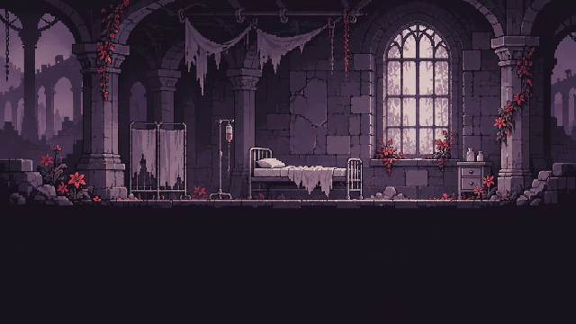
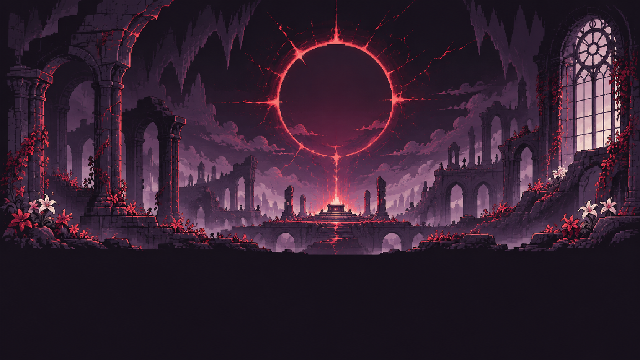
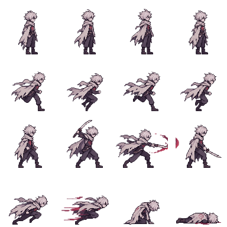
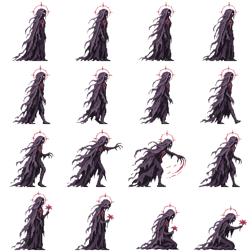
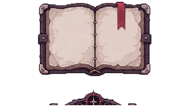

# THE ROOM REMEMBERS

<p align="center">
  
</p>

<p align="center">
  <strong>You forget. It remembers.</strong><br/>
  <em>TORIMON</em> · Godot 4.7 · Android-first · Turkish UI
</p>

<p align="center">
  <a href="https://github.com/jagwey/THE-ROOM-REMEMBERS/releases"></a>
  
  
</p>

---

## Hikâye

Uyanıyorsun. Oda seni tanıyor — sen onu unutmuş olsan bile.

**THE ROOM REMEMBERS**, yan görünüşlü bir bellek / lanet oyunudur. Shiren’i yönetirsin; Bekçi seni izler, uyarır, engeller. Ölünce dünya unutmaz: cesetler, yankılar ve izler kalır. Lanet erken bir HUD barı olarak değil; kırmızı perde, fısıltı ve sarsıntı olarak gelir.

İki yol:

- **Kötü** — Bekçi’ye saldırıların döngüyü sürdürür  
- **İyi** — ağırlık, bellek kodu, yankı ve güvenle Çekirdek’i mühürlersin

---

## Görseller

<p align="center">
  
</p>

<p align="center"><em>Awakening — oda seni hatırlıyor</em></p>

<p align="center">
  
</p>

<p align="center"><em>Core — mühür ve lanetin kalbi</em></p>

| Karakter / Prop | |
|:--:|:--:|
|  |  |
| *Shiren* | *Bekçi (Keeper)* |
|  |  |
| *Kristal* | *Lanet işareti* |
|  |  |
| *Günlük* | *Halo / VFX* |

---

## Özellikler (dikey dilim v0.8)

- Mobil joystick + saldırı / dash / etkileşim / günlük
- Scripted Bekçi: gözlem → uyarı → müdahale (erken öldürme yok)
- Ölüm / yeniden doğuş + dünya hafızası (ceset ≤ 3)
- Yankı → oyuncu günlüğü (Günlük / Notlar / İzler)
- Ağırlık plakası + bellek kodu **314**
- Lanet VFX (veil / halo / fısıltı); %100 → hayat biter, dünya kalır
- İyi / kötü son; Awakening + Core parallax; moodboard paleti

Türkçe oynanış notları: [`PLAY_TR.md`](PLAY_TR.md)

---

## Çalıştır (masaüstü)

1. Bu klasörü **Godot 4.7.2** ile aç  
2. Ana sahne: `scenes/main/main.tscn`  
3. **F5**

| Klavye | Aksiyon |
|--------|---------|
| WASD / oklar | Yürü |
| **Z** / **J** | Saldır |
| **X** / **K** | Dash |
| **E** / **F** | Etkileş |
| **I** / **Tab** | Günlük |

---

## Android debug APK

**Hazır indirme:** [Releases](https://github.com/jagwey/THE-ROOM-REMEMBERS/releases) → `TheRoomRemembers-debug.apk`  
Paket: `com.torimon.theroomremembers` · arm64-v8a · v0.8.0

Kendin derlemek için: preset `export_presets.cfg` → **Android**.

```powershell
# Windows: repo yolu ASCII değilse (örn. プロジェクト) imza için ASCII çıktı yolu kullan
New-Item -ItemType Directory -Force -Path $env:TEMP\torimon-build, build\android | Out-Null
godot --headless --path . --export-debug "Android" "$env:TEMP\torimon-build\TheRoomRemembers-debug.apk"
Copy-Item "$env:TEMP\torimon-build\TheRoomRemembers-debug.apk" build\android\ -Force
```

Gereksinimler: JDK 17+, Android SDK (`platforms;android-34`, `build-tools;34.0.0`), Godot export templates **4.7.2.stable**.

---

## Studio

**TORIMON** — *You forget. It remembers.*

Sanat kaynağı (yerel moodboard pack): `bekci` klasörü. Oyunda kullanılan PNG / SpriteFrames bu repoda `assets/` altında.
