# THE ROOM REMEMBERS

<p align="center">
  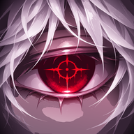
  &nbsp;&nbsp;&nbsp;
  
</p>

<h2 align="center">
  <strong>Sen unutursun. O hatırlar.</strong><br/>
  <em>You forget. It remembers.</em>
</h2>

<p align="center">
  <strong>TORIMON</strong> · Gotik Psikolojik Aksiyon-Bulmaca &amp; Kalıcı Bellek Platform Oyunu · Godot 4.7 · Android &amp; PC
</p>

<p align="center">
  <a href="https://github.com/jagwey/THE-ROOM-REMEMBERS"></a>
  <a href="https://github.com/jagwey/THE-ROOM-REMEMBERS-release/releases"></a>
  <a href="https://godotengine.org/"></a>
  
  
</p>

> **Kapalı kaynak / Proprietary.** Bu depo **private** tutulur; kaynak kod paylaşılmaz. Oyunculara yalnızca derlenmiş APK, public [THE-ROOM-REMEMBERS-release](https://github.com/jagwey/THE-ROOM-REMEMBERS-release/releases) deposundan dağıtılır. © TORIMON — Tüm hakları saklıdır.

---

<p align="center">
  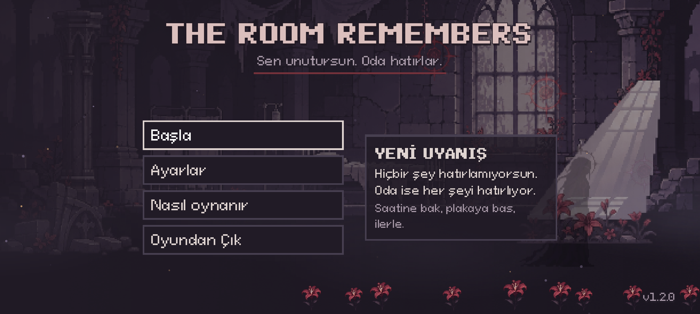
</p>

---

## 📖 Oyun Hakkında

> *"Gözlerin aralanır. Taş soğuk, tavan yüksek, adın yabancı. Sen öldüğünde hafızan sıfırlanır — fakat oda bıraktığın her bedeni, kırdığın her mührü ve verdiğin her sözü hatırlar."*

**THE ROOM REMEMBERS**, ölümün bir yenilgi değil, **dünyayı değiştiren fiziksel ve anlatısal bir bulmaca aracı** olduğu karanlık gotik bir 2D aksiyon-platform oyunudur.

Oyuncu **Noroi** olarak ne adını ne de neden bu yıkık ve zamandan kopuk yeraltı tesisinde tutulduğunu bilerek uyanır. Her ölümde Noroi'nin o yaşamdaki hatıraları silinir; fakat **oda hiçbir şeyi unutmaz**. Önceki yaşamlarından kalan kendi cansız bedenlerin odalarda kalıcı olarak durur:
* Üzerlerine basıp yüksek çıkıntılara tırmanabilirsin (`one_way_collision`),
* Ağır taş basınç plakalarının üstüne itip kapıları açık tutabilirsin (`anchoring`),
  * **Canlı plaka kuralı:** plaka yalnızca taş/ceset ağırlığıyla basılır (oyuncu tek başına basamaz); kapı ağırlık durdukça açıktır, ağırlık kalkınca kapanır. Kapıdan karşı tarafa geçildiği anda bulmaca kalıcı çözülür (*geçiş kilidi*). Eski kayıtlarda çözülmüş bulmaca çözülü kalır.
  * İstisna: `latch_on_press` plakası (yalnız Kripta `BedPlate`) basıldığı anda kalıcı çözülür; `accept_player` ve `latch_on_press` beyaz listesi `plate_rule_audit` ile denetlenir.
  * Faz 2 odalar 07-10: Sarmaşık (çiçekli ceset `vine_gate`'i 64 px içinde yakar, `decay_vines`), Ağırlık (kapı `decay_weight_latch` VE yalnız-ceset `decay_weight_corpse` ister; eski kayıtta latch yeter), Sera (3 yalnız-ceset saksı plakası, doğrusu `decay_greenhouse_pot`; `trace_shade` doğruyu gösterir, `WallInscription` 7-2-9 kaynağı; kapı geçişte eski `decay_greenhouse`'i de çözer), Shilda Duvarı (x200-480 lanet bulutu, düz yürüyüş ~%72 lanet, ceset kalkanıyla ~%10; `FlowerRoom` artık `echo_point`, `shilda_flowers_echo`; kapılar x1120/x1400; `WallThorn` ve yanlış saksı dikenleri kendi çözülmeyen ipucu id'siyle her zaman ölümcül, eski kayıtta çözülmüş oda günlükte ceset ipucu göstermez).
  * **Son Merdiven (`core_ascent`) üç sınav:** soldan sağa Ruh Kesimi mührü (`core_ascent_seal`), 120 px yüksekliğinde Gölge Atılması perdesi (zıplayarak aşılamaz; zıplama tepesi ~58 px; boşluk yok, `core_ascent_gap` ID'si yalnız kayıt uyumu için), yankı plakası (`core_ascent_echo`: sunak + plaka + kapı). Ret repliği yeteneğin alındığı odayı adlandırır (Yasak Kanat, Ayna Tapınağı); `ascent_audit` denetler.
  * **Metin ve veri tutarlılığı (Faz 0 T5):** Yankı Sunağı kayıt süresi her yerde sekiz saniyedir; Çiçeklenme bahçesi ipucu "önce en çok, sonra en az, sonra kalan"; Unutulmuş Sayfa ipucu deney, kapı, mühür sırasını verir; hücre çıkış kapısı `ForwardIntake`; kullanılmayan `core_portal.gd` kaldırıldı.
  * **Ayna Tapınağı kapısı:** `mirrors_unbroken` sağ yan kapısı `Ayna Tapınağı` başlığı ve nabız atan mor ışıkla (`DoorMark`) işaretlidir; Shilda ilk yüzleşmede tapınağa yönlendirir. `SIDE_DOORS` girişleri isteğe bağlı `title`/`mark`/`label_dy` alır, `door_audit` her yan kapı hedefinde `from_<kaynak>` spawn'ını denetler.
* Son 3 saniyelik mor **Yankı Tekrarlarını (Echo Replay)** izleyerek ölüm anındaki sırları çözebilirsin,
* **Beyaz Bekçi Shilda**'nın bedenlerine bıraktığı kızıl ölüm çiçeklerinin ışığıyla karanlıkta gizlenen antik mühürleri ortaya çıkarabilirsin.

<p align="center">
  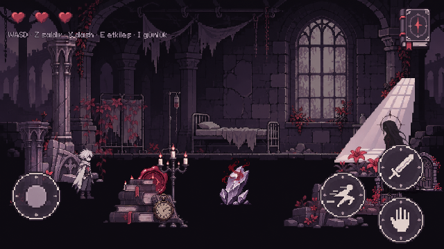
</p>

---

## 🏛️ Mimari ve Sistem Tasarımı

### 1. Üç Katmanlı Bellek ve Kalıcı Dünya Döngüsü (3-Layer Memory & Death Loop)

Oyun, ölüm anında neyin silinip neyin kalıcı olacağını katı bir mimariyle ayırır:

```mermaid
flowchart TD
    subgraph Oyuncu["🗡️ Noroi (Oyuncu)"]
        Life["Geçici Yaşam Belleği<br/>(character_current_life_knowledge)<br/>• Anlık diyalog bayrakları<br/>• Geçici oda etkileşimleri"]
        Curse["Lanet Seviyesi (%0 - %100)<br/>(CurseManager.curse)<br/>• Diken/Düşman/Ölümle artar"]
    end

    subgraph Olum["💀 Ölüm Anı (DeathManager)"]
        DeathEvent["Ölüm Tetiklenir<br/>(Diken / Uçurum / Hasar)"]
        SafeFloor["Son Güvenli Zemin Belirleme<br/>(_safe_floor_pos)"]
        CorpseDrop["Fiziksel Ceset Bırakılır<br/>(corpse.tscn)"]
    end

    subgraph Dunya["🏛️ Kalıcı Dünya (Oda Hatırlar — world_memory_state)"]
        Bodies["Kalıcı Fiziksel Bedenler<br/>• Basamak & Platform<br/>• Plaka Ağırlığı (Anchoring)<br/>• Lanet Süngeri<br/>• Yankı Tekrarı (Echo Replay)"]
        Puzzles["Kalıcı İlerleme<br/>• Açılan Gotik Kapılar<br/>• Kırılan Taş Duvarlar<br/>• Çözülen Bulmacalar (PuzzleManager)"]
        ShildaRel["Shilda Güven Mimarisi<br/>• Bedenlere Yas Çiçeği (Fener Ceset)<br/>• Koruyucu Kalkan (Ward)<br/>• Bölge Bazlı Evre Replikleri"]
    end

    subgraph Muhur["🕯️ Lanet Mühürleme Noktaları (MemorySealPoint)"]
        SealCheck{"Oyuncuda Lanet Var mı?<br/>(curse > 0.0)"}
        SealReject["Lanetsiz: Reddedilir<br/>'Kanımda aktif bir lanet yok...'"]
        SealAbsorb["Lanetli: Lanet Emilir (%0)<br/>+ Kalıcı Kayıt Yazılır (commit_save)<br/>+ Afiş: LANET MÜHÜRLENDİ"]
    end

    Life -->|Ölüm| DeathEvent
    DeathEvent --> SafeFloor --> CorpseDrop --> Bodies
    DeathEvent -->|+%25 Lanet Ekle| Curse
    DeathEvent -->|Oda İçi Güvenli Yeniden Doğuş| Life
    Bodies --> Dunya
    Puzzles --> Dunya
    Curse -->|Mühür Noktası Etkileşimi| SealCheck
    SealCheck -->|Hayır (<=0%)| SealReject
    SealCheck -->|Evet (>0%)| SealAbsorb
    SealAbsorb -->|Kayıt Mühre Kazınır| Dunya
```

---

### 2. Godot 4.7 Engine Sistem Mimarisi & Autoload Hub

Oyunun tüm alt sistemleri, 14 adet hafif ve otonom Autoload modülü üzerinden haberleşir:

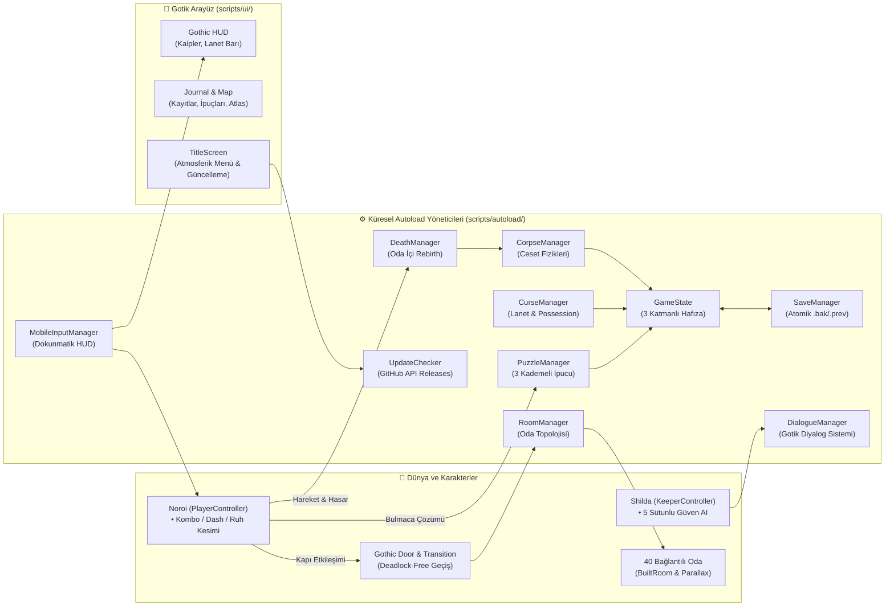

---

### 3. Dünya Atlası: 6 Bölge ve 40 Bağlı Oda

Tesis, birbirinden farklı görsel atmosfere, Gotik mimariye ve bulmaca dinamiklerine sahip 6 ana bölgeden oluşur:

```mermaid
flowchart LR
    Z1["🏛️ <b>Bölge I</b><br/>Uyanış Mahmuzu<br/><i>Awakening</i><br/>(Oda 01 - 06)"]
    Z2["🌿 <b>Bölge II</b><br/>Çürüme Bahçesi<br/><i>Decay</i><br/>(Oda 07 - 13)"]
    Z3["📚 <b>Bölge III</b><br/>Hafıza Kütüphanesi<br/><i>Library</i><br/>(Oda 14 - 20)"]
    Z4["⚗️ <b>Bölge IV</b><br/>Yasak Laboratuvar<br/><i>Experiment</i><br/>(Oda 21 - 27)"]
    Z5["🪞 <b>Bölge V</b><br/>Aynalar Salonu<br/><i>Mirrors</i><br/>(Oda 28 - 34)"]
    Z6["💠 <b>Bölge VI</b><br/>Bellek Çekirdeği<br/><i>Core</i><br/>(Oda 35 - 40)"]

    Z1 -->|Taş Bulmacası & Sağ Kapı| Z2
    Z2 -->|Arşiv Kapısı & Shilda Güveni| Z3
    Z3 -->|Ruh Kesimi (SoulSlash)| Z4
    Z4 -->|Karantina & Lanet Koridoru| Z5
    Z5 -->|Gölge Atılması & 729 Mührü| Z6
    Z6 -->|2 Mühür Parçası + Çekirdek Kristali| Final["🎬 <b>BÖLÜM I SONU</b><br/>(Tek Kanonik Final)"]
```

---

### Katakomb çiçeği ve Sarnıç (Faz 0)
Kemik Mahzeni girişinde (x≈150) tükenmez bir çiçek kaynağı durur. Çiçek elde ölürsen ceset çiçeği taşır ve fener gibi yanar; karanlık yol aydınlanır. Çiçek hayat başınadır, ölümde cesede geçer ve elden silinir. Sarnıç yan kapısı artık yetenek istemez.

### v1.15.0 (hazır, yayınlanmadı) — Faz 1 diyalog yeniden yazımı
- **Kapsam:** tüm oda, Shilda/Gölge, sistem ve arayüz metinleri sade Türkçeye yeniden yazıldı (T3–T6). Oda/puzzle/flag/relic ID'leri, `when` koşulları, bulmaca çözümleri değişmedi. Sürüm: `project.godot` 1.15.0, `version/code` 45.
- **Lint kuralları (`dialogue_lint_audit`, T1):** `three_dots` ("..." yerine "…"), `banned_word` (hatıra/bellek yasak), `english_residue` (`BÖLGE %02d`, `BÖLÜM I SONU` vb. kalıntı yok), `json_shilda_speaker`, `line_length`, `hint_length` (HUD ipucu en çok 70 karakter), `speaker_format`, `unknown_placeholder`.
- **Elle denetlenen stil kuralları (lint doğrulamaz):** Shilda satırları 2–8 kelime, ipucu fiille biter, Noroi satırları tek cümle.
- **Canon kontrolleri (`lore_canon_audit`, T2):** `x_name_late`, `vault_irony`, `garden_hint`, `witness_order`, `shilda_human_late`, `intake_flower_owner`, `pre_name_shilda` ve diğerleri (`no_hundreds`, `night_1927`).
- **Oda başlıkları (T1'de kesinleşti, tek kaynak `RoomManager.ROOM_TITLES_TR`):** `experiment_quarantine` → "Karantina Mahzeni", `mirrors_1927` → "1927 Gecesi".
- **Öne çıkan değişiklikler:** X'in kimliği `mirrors_1927` sonunda açılır ("Bana X deyin"); bölge kartı "Uyanış Mahmuzu" → "Uyanış Odası"; "███" → "[kazınmış]".
- **Durum:** yayınlanmadı; rozet ve indirme bağlantıları v1.13.0'da kalır.
- **Faz 2 odalar 01-03 (T4):** Uyanış Odası kapısı taş plakası + yalnız-ceset plaka ister (ilk ölüm dersi: plakadaki dikenli kök); Gözlem Balkonu ruh mührünü kaybetti; boşluğun iki yanındaki sütunlar (64 px) düz zıplamayla aşılamaz, kan kristaliyle ölüp bedenini basamak yaparak geçilir (dönüş için karşı yakada ikinci kristal), karşıdaki geçiş alanı kapıyı açar, teleskop halka kodunun ilk hanesini (3) gösterir; Mahzen'de defter sayfaları tarih sırasına dizilir, yataktaki ceset anıyı açar ve 2.-3. haneleri (1, 4) verir. Eski `soul_seal_balcony` kayıtları geçerli kalır.
- **Faz 2 odalar 04-06 (T5):** Kırık Geçit kısaldı (1500 px); çıkış, yankıdaki sırayla (3-1-4) dokunulan üç halkaya bağlı ve yüksek basamak ancak kan kristaliyle bırakılan bedenle aşılır. Mühür Odası iki plaka ister: iki ayrı beden, iki plaka; yanlış mühür kodu laneti artırır. Nöbet Odası'nda gölge üç soru sorar (cevaplar güveni ±1 değiştirir), sonra üç iz gölgesinden yalnız biri kapıya kadar yürür; konuşma ve iz tamamlanınca yol açılır.

### v1.14.0 (hazır, yayınlanmadı) — Faz 0 kritik düzeltmeler
- **Canlı plaka kuralı:** plaka yalnız üstünde ağırlık varken kapıyı açar; içinden geçince kapı kalıcı çözülür ve kaydedilir (`PuzzleManager.set_live/is_live`).
- **Yükseliş (`core_ascent`):** üç ayrı yetenek sınavı — Ruh Kesimi mührü, Gölge Atılması perdesi, yankı sunağı+plaka. Eski kayıtlar ilerlemeyi korur.
- **Ayna Tapınağı kapısı:** `mirrors_unbroken` yan kapısı nabız atan işaret ve başlıkla görünür.
- **Katakomb çiçeği / Sarnıç:** yukarıdaki bölüm; softlock'lar kapandı.
- **Metin düzeltmeleri:** Çiçeklenme ve sayfa ipuçları gerçek sırayla eşleşir, yankı kaydı tek sabit 8 sn, ölü `core_portal.gd` silindi.
- **Shilda sprite:** ayaklar zemine oturur (offset −59), balkon gözlem noktası boşluktan çıkarıldı.
- e2e sürüm kontrolü artık `project.godot` ile `export_presets.cfg` tutarlılığını denetler (sabit sürüm yok).

## 🎨 Karakterler ve Görsel Yenileme (Shilda HD Remaster)

v1.12.5 görsel düzenlemesi `assets/trr_refresh/` içinden 16 PNG kullanır. Saatler Odası, Gözlem Camı, Kırık Gece ve Sera'da yeni nesne çizimleri mevcut etkileşim noktalarına bağlanır. Kütüphane ve deney alanında duvar çizimleri dekoru taşır. Çürüme ve ayna bölgelerindeki tavan motifleri 320 piksel aralıklıdır. Diyalog çerçeveleri konuşmanın tonuna göre değişir. Finalde dört alan için ayrı ekran çizimi kullanılır.

### Shilda — Beyaz Muhafız (The White Guardian v2.0 HD)
Shilda'nın tüm piksel sanatı 1:1 224x224 yerel ölçekte yeniden işlenmiş, 557.049 piksellik alfa sisi temizlenmiş ve 8 farklı duygusal portre eklenmiştir:

<p align="center">
  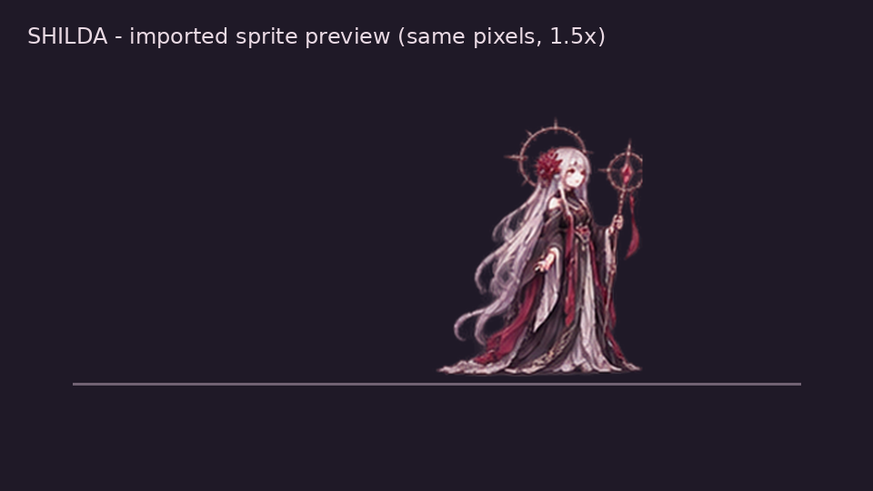
</p>

#### Shilda Duygu Portreleri Matrisi (`assets/portraits/shilda/`)
| `neutral` | `gentle` | `smile` | `sad` | `worried` | `angry` | `determined` | `eyes_closed` |
| :---: | :---: | :---: | :---: | :---: | :---: | :---: | :---: |
|  |  |  |  |  |  |  |  |

<p align="center">
  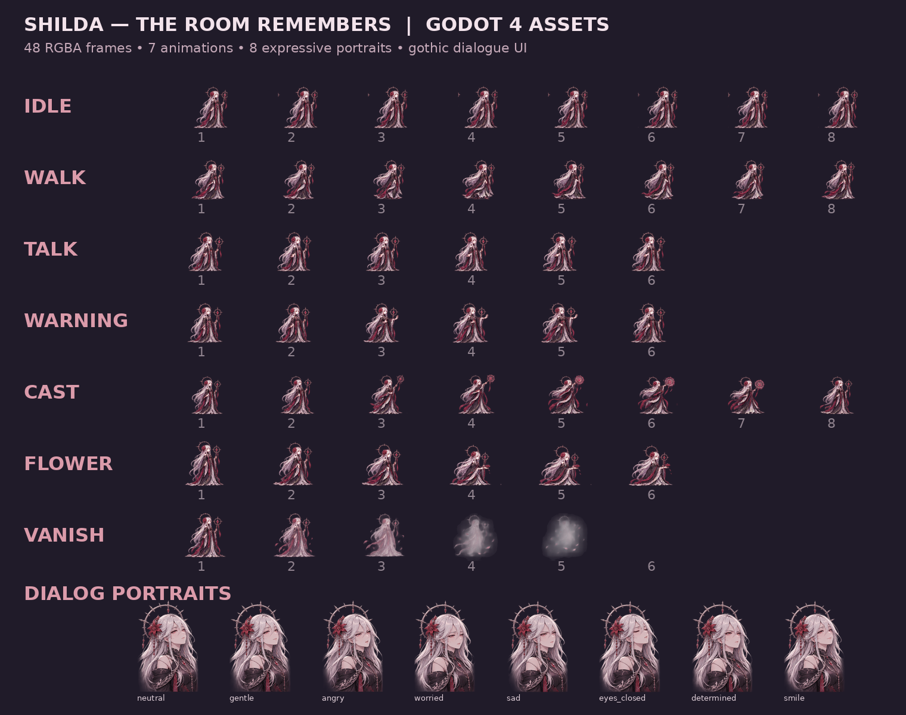
</p>

---

## 🕯️ Karakterler, Semboller ve Etkileşim Unsurları

| Görsel | Unsur | Rolü ve Mekanik İşlevi |
| :---: | :--- | :--- |
|  | **Noroi**<br/>*(Oyuncu)* | Her ölümde belleği sıfırlanan fakat dünyada bıraktığı izlerle gerçeğe yürüyen denek. 3'lü kılıç kombosu, **Gölge Atılması (`ShadowDash`)** ve **Ruh Kesimi (`SoulSlash`)** yeteneklerini kullanır. |
|  | **Shilda — Bekçi**<br/>*(The Keeper)* | Odanın hafızasını koruyan figür. Bedenlerinin başında yas tutar, çiçek bırakır. Ona saldırmak ya da güvenmek oyunun sonunu doğrudan belirler. |
|  | **Önceki Bedenler**<br/>*(Corpse & Echo)* | Öldüğün noktada kalan fiziksel bedenin. İlk incelemede son 3 saniyelik **Yankı Tekrarını** oynatır; sonrasında **itilebilir ağırlık**, **üzerine çıkılabilir platform** ve **lanet süngeri** olur. |
|  | **Kızıl Ölüm Çiçeği**<br/>*(Mourning Flower)* | Shilda'nın yas tuttuğu bedenlere bıraktığı çiçek. Çiçekli bedenler (**Fener Ceset**) karanlık odaları aydınlatır ve duvarlardaki gizli sembolleri görünür kılar. |
| 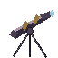 | **Teleskop & Dış Boşluk**<br/>*(Void Observation)* | Balkondaki antik aygıt. Tesisin gerçek dünyadan kopuk, yıldızsız ve donmuş karanlık bir boşlukta asılı olduğunu ortaya koyar. |
| 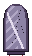 | **Çatlak Bellek Aynası**<br/>*(Cracked Mirror)* | Bölgeler arası tek kanonik hızlı seyahat ağı. Keşfedilen tapınaklar arasında hafıza sıçraması sağlar. |

---

## 📸 Ekran Görüntüleri Galerisi

<p align="center">
  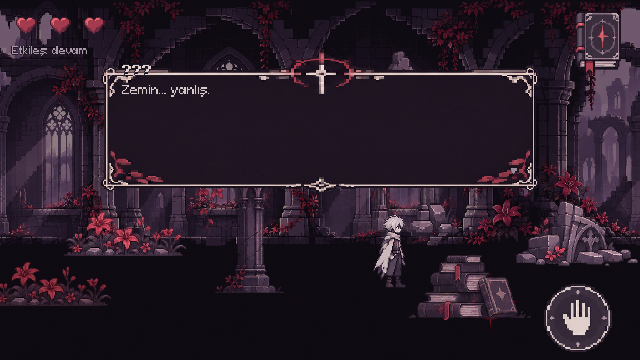
  &nbsp;
  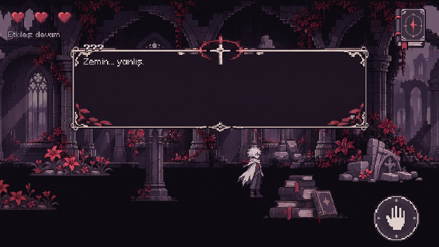
</p>
<p align="center">
  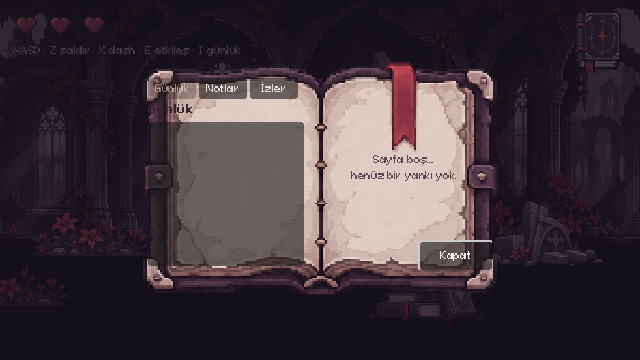
  &nbsp;
  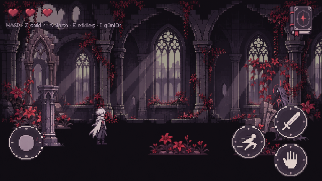
</p>
<p align="center">
  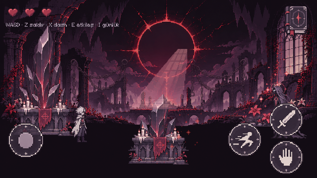
</p>

---

## 📦 Aktif Sürümler ve İndirme Bağlantıları (GitHub Releases)

Depodaki tüm derlenmiş Android (`arm64-v8a`) APK paketleri düzenli olarak **[GitHub Releases](https://github.com/jagwey/THE-ROOM-REMEMBERS-release/releases)** sayfasında sunulmaktadır:

| Sürüm | Durum | APK Dosyası / İndirme | Öne Çıkan Yenilikler ve Kapsam |
| :--- | :---: | :--- | :--- |
| **[v1.13.0](https://github.com/jagwey/THE-ROOM-REMEMBERS-release/releases/tag/v1.13.0)** | 🟢 **Güncel** | [📥 `TheRoomRemembers-1.13.0-android-arm64.apk`](https://github.com/jagwey/THE-ROOM-REMEMBERS-release/releases/download/v1.13.0/TheRoomRemembers-1.13.0-android-arm64.apk) | Kararlılık ve metin cilası: possession/kapı geçişinde otomatik kayıt atlanır, cesetler aktif odaya doğar, yetenek alımı kaydı kalıcı, bozuk kayıtta yedeğe dönüş, kullanılmayan son ses tetikleyicileri kaldırıldı; 10 diyalog dosyasında Noroi/Shilda replikleri sıkılaştırıldı, lore tutarlılığı (kuruluş, 1995, "altmış sekiz yıl"), Shilda duvarı ipucu gerçek kuralla eşleşti; v1.12.5 ile aynı imza (`versionCode 43`). |
| **[v1.12.5](https://github.com/jagwey/THE-ROOM-REMEMBERS-release/releases/tag/v1.12.5)** | Önceki | [📥 `TheRoomRemembers-1.12.5-android-arm64.apk`](https://github.com/jagwey/THE-ROOM-REMEMBERS-release/releases/download/v1.12.5/TheRoomRemembers-1.12.5-android-arm64.apk) | Görsel yenileme: `assets/trr_refresh/` içinden 16 PNG (Saatler Odası, Gözlem Camı, Kırık Gece, Sera nesneleri; diyalog çerçeveleri; final alan ekranları), seyrek tavan motifleri, HUD sadeleştirme; v1.12.4 ile aynı imza (`versionCode 42`). |
| **[v1.12.4](https://github.com/jagwey/THE-ROOM-REMEMBERS-release/releases/tag/v1.12.4)** | Önceki | [📥 `TheRoomRemembers-1.12.4-android-arm64.apk`](https://github.com/jagwey/THE-ROOM-REMEMBERS-release/releases/download/v1.12.4/TheRoomRemembers-1.12.4-android-arm64.apk) | Kırık Geçit kolaylaştırıldı: diken halkası artık öldürmez (bir kalp hasarı, ölüm döngüsü yok), boşluk 230°, dönüş 0.3 rad/s, doğuş koruması 3 sn; v1.12.3 ile aynı imza (`versionCode 41`). |
| **[v1.12.3](https://github.com/jagwey/THE-ROOM-REMEMBERS-release/releases/tag/v1.12.3)** | Önceki | [📥 `TheRoomRemembers-1.12.3-android-arm64.apk`](https://github.com/jagwey/THE-ROOM-REMEMBERS-release/releases/download/v1.12.3/TheRoomRemembers-1.12.3-android-arm64.apk) | Kayıt sağlamlığı ve softlock korumaları, kanon metin düzeltmeleri (1995 yalnız Perde 3+, Shilda geçmişi Yetki Masası itirafıyla), güncelleme denetleyicisi sağlamlaştırma; v1.12.2 ile aynı imza (`versionCode 40`). |
| **v1.12.2** | Önceki | APK bu sürümde ayrıca yayınlanır | Sol ve sağ yürüme hızı eşit; lanet kendiliğinden yürütmez; hitstop ve ölüm ağır çekimi `time_scale` değerini 1.0'a döndürür (`versionCode 39`). |
| **v1.12.1** | Önceki | APK bu sürümde ayrıca yayınlanır | Kırık Geçit geçilebilir: taş blok zıplama yüksekliğinde, diken halkasının hitbox'ı görselle aynı, dönüş boşluğu ve halkanın dışında kontrol noktası (`versionCode 38`). |
| **v1.12.0** | Önceki | APK bu sürümde ayrıca yayınlanır | Kısa nöbet, ceset basamağı, vuruş ve ölüm hissi cilası, oda girişi kamerası (`versionCode 37`). |
| **[v1.9.0](https://github.com/jagwey/THE-ROOM-REMEMBERS-release/releases/tag/v1.9.0)** | Önceki | [📥 `TheRoomRemembers-1.9.0-android-arm64.apk`](https://github.com/jagwey/THE-ROOM-REMEMBERS-release/releases/tag/v1.9.0) | Derin oynanış geçişi: sıralı bahçe ve kasa, yalan ayna, raf tahtası, kademeli günlük ipucu (`versionCode 34`). |
| **[v1.8.1](https://github.com/jagwey/THE-ROOM-REMEMBERS-release/releases/tag/v1.8.1)** | Önceki | [📥 `TheRoomRemembers-1.8.1-android-arm64.apk`](https://github.com/jagwey/THE-ROOM-REMEMBERS-release/releases/tag/v1.8.1) | Hareket kilidi, taş itme ve kapı etkileşimi düzeltildi; bölge motifleri, diyalog cilası (`versionCode 33`). |
| **[v1.8.0](https://github.com/jagwey/THE-ROOM-REMEMBERS-release/releases/tag/v1.8.0)** | Önceki | [📥 `TheRoomRemembers-1.8.0-android-arm64.apk`](https://github.com/jagwey/THE-ROOM-REMEMBERS-release/releases/tag/v1.8.0) | Kapı sonrası joystick restorasyonu, door_controls audit, Bölüm II teaser, ???/X? portreleri (`versionCode 32`). |
| **[v1.7.0](https://github.com/jagwey/THE-ROOM-REMEMBERS-release/releases/tag/v1.7.0)** | Önceki | [📥 `TheRoomRemembers-1.7.0-android-arm64.apk`](https://github.com/jagwey/THE-ROOM-REMEMBERS-release/releases/tag/v1.7.0) | Shilda HD Remaster, 3 katmanlı bellek, oda içi güvenli yeniden doğuş, lanet mühürleme tapınakları (`versionCode 31`). |
| **[v1.6.0](https://github.com/jagwey/THE-ROOM-REMEMBERS-release/releases/tag/v1.6.0)** | Önceki | [📥 `TheRoomRemembers-1.6.0-android-arm64.apk`](https://github.com/jagwey/THE-ROOM-REMEMBERS-release/releases/tag/v1.6.0) | Shilda White Guardian V2 HD Remaster, 3 Katmanlı Hafıza İzolasyonu, 3 Kademeli İpuçları (`versionCode 30`). |
| **[v1.5.1](https://github.com/jagwey/THE-ROOM-REMEMBERS-release/releases/tag/v1.5.1)** | Önceki | [📥 `TheRoomRemembers-1.5.1-android-arm64.apk`](https://github.com/jagwey/THE-ROOM-REMEMBERS-release/releases/tag/v1.5.1) | Gotik metin cilası, X kanonu uyumu, 314 rüya ipucu (`versionCode 29`). |
| **[v1.0.0](https://github.com/jagwey/THE-ROOM-REMEMBERS-release/releases/tag/v1.0.0)** | Arşiv | [📥 `TheRoomRemembers-1.0.0-android-arm64.apk`](https://github.com/jagwey/THE-ROOM-REMEMBERS-release/releases/tag/v1.0.0) | İlk kararlı Android sürümü, 30 bağlı oda, dokunmatik kontroller. |

---

## 🎮 Kontroller

| Eylem | Masaüstü (Klavye) | Android (Dokunmatik HUD) |
| :--- | :--- | :--- |
| **Hareket** | `A / D`, `Sol / Sağ Ok` | Sol Sanal Joystick (Sabit veya Yüzen mod) |
| **Zıplama** | `W`, `Space`, `Yukarı Ok` | Sağ HUD — **Zıpla (`^`)** *(Coyote + Değişken Yükseklik)* |
| **Saldırı (3'lü Kombo)** | `Z` veya `J` | Sağ Alt — **Kılıç** Butonu |
| **Atılma / Gölge Atılması** | `X` veya `K` | Sağ Alt — **Dash** Butonu |
| **Etkileşim / İtme / Konuşma** | `E` veya `F` | Sağ Orta — **El (`Interact`)** Butonu |
| **Yetenek (Ruh Kesimi)** | `C` veya `L` | Sağ HUD — **Ruh Kesimi (`Skill`)** Butonu |
| **Günlük & Harita** | `I` veya `Tab` | Sağ Üst — **Günlük (Kitap)** İkonu |
| **Duraklatma & Ayarlar** | `Esc` | Sağ Üst — **Menü** Butonu / Android Sistem Geri Tuşu |

---

## 🚀 Kurulum, Çalıştırma ve Test Altyapısı

### 1. Android Cihaza Kurulum (APK)
1. **[Releases](https://github.com/jagwey/THE-ROOM-REMEMBERS-release/releases)** sayfasından son sürüm `.apk` dosyasını indirin.
2. Veya USB hata ayıklaması açık cihaza `adb` ile yükleyin:
   ```powershell
   adb install -r TheRoomRemembers-1.13.0-android-arm64.apk
   adb shell am start -n com.torimon.theroomremembers/com.godot.game.GodotApp
   ```

### 2. Godot Editöründe Çalıştırma (Geliştirici)
1. **[Godot Engine 4.7.2](https://godotengine.org/download)** konsol veya standart sürümünü indirin.
2. Depoyu açın ve `project.godot` dosyasını projeye yükleyin:
   ```bash
   git clone https://github.com/jagwey/THE-ROOM-REMEMBERS.git
   cd THE-ROOM-REMEMBERS
   ```
3. Ana sahne `scenes/main/main.tscn` olarak ayarlıdır; **F5** ile doğrudan başlatabilirsiniz.

### 3. Otomatik Headless QA ve Audit Testleri (`scripts/dev/`)
Projeyi kod tabanı seviyesinde doğrulayan 20'den fazla otonom test betiği bulunur:

```powershell
$godot = "C:\Users\Osman\OneDrive\Desktop\Godot_v4.7.2-stable_win64.exe\Godot_v4.7.2-stable_win64_console.exe"
$env:TORIMON_TEST = "1"

# 1. Master E2E Doğrulama (Tier 1-4, 50 kontrol)
& $godot --headless --path . -s res://scripts/dev/e2e_runner.gd

# 2. 40 Oda ve Kapı Grafiği Bütünlüğü Denetimi
& $godot --headless --path . -s res://scripts/dev/release_audit.gd

# 3. Ölüm, Rebirth ve Kalıcı Dünya Denetimi
& $godot --headless --path . -s res://scripts/dev/death_loop_audit.gd

# 4. Lanet ve Mühür Tapınakları Denetimi
& $godot --headless --path . -s res://scripts/dev/memory_seal_audit.gd
```

> **Sürüm hazırlık raporları:** `qa/release-readiness/` altında v1.12.2 için QA/Google Play hazırlık raporları (oda matrisi, hikâye denetimi, hata kaydı, Play kontrol listesi, GO/NO-GO) bulunur. Mevcut karar: NO-GO (cihaz/insan testi, AAB, imza ve politika eksikleri). Kanıtlar yalnız headless/statik; gerçek cihaz testi yapılmadı. Çalışma kopyasında (commit edilmemiş) kayıt sağlamlığı, kilitlenme korumaları ve kanon metin düzeltmeleri yapıldı; yeni denetimler `softlock_reset_audit.gd` ve `save_robustness_audit.gd`, hepsi `docs/gelistirme/Run-Audit.ps1` içinde. Play yayını için taslaklar `docs/play/` altında (kontrol listesi, gizlilik taslağı, lisans listesi, mağaza metni). Play sürümünde güncelleme düğmesini kapatmak için export ön ayarına `play_store` özel özelliği eklenmelidir (`UpdateChecker.is_disabled_build()`). Kanon kararları (otonom, geri alınabilir): 1995 yalnız Perde 3+ içinde okunur; `shilda_past_discovered` Yetki Masası itirafında set edilir; `lore_canon_audit` CANON-A/B bunları korur. Tempo (ana yol ~43 dk) açık, mağaza metni süre vaat etmiyor. Mağaza görselleri taslağı `docs/play/store/` altındadır (öne çıkan görsel 1024×500 + aday ekran görüntüleri; yakalama aracı `scripts/dev/room_visual_capture.gd`).

---

## 📜 Geliştirici & Ajan Kuralları

Projeye katkı veren her yapay zekâ ajanı, alt ajan veya geliştirici aşağıdaki kurallara **kesinlikle** uyar:
1. **GÖREV SONU DOKÜMANTASYON KURALI (ZORUNLU):** Her ajan / alt ajan bir işi, revizyonu veya görevi bitirdiğinde; yapılan tüm değişiklikleri, yeni mekanikleri, mimari detayları ve sürüm bilgisini MUTLAKA `README.md` ve `PROGRESS.md` dosyalarına yansıtacaktır. Dokümantasyon asla bayat bırakılamaz.
2. **Kanonik Dil Standardı:** Kod tanımlayıcıları İngilizce (`snake_case` fonksiyonlar, `PascalCase` sınıflar), oyun içi metinler ve diyaloglar mutlaka **Türkçe (UTF-8)** olmalıdır.
3. **Kalıcı Dünya İlkeleri:** Ölüm durumunda dünya ilerlemesi (açılan kapılar, çözülen bulmacalar, kırılan duvarlar) asla sıfırlanmaz.
4. **Tek Kanonik Final:** Hikâye Part I için tek bir kanonik son içerir (`BÖLÜM I SONU`). Eski alternatif son dalları geçersizdir.

---
<p align="center">
  <sub>TORIMON STUDIO · THE ROOM REMEMBERS · 2026</sub>
</p>
