# THE ROOM REMEMBERS

<p align="center">
  
  &nbsp;&nbsp;&nbsp;
  
</p>

<h2 align="center">
  <strong>Sen unutursun. O hatırlar.</strong><br/>
  <em>You forget. It remembers.</em>
</h2>

<p align="center">
  <strong>TORIMON</strong> · Gotik Psikolojik Aksiyon-Bulmaca &amp; Kalıcı Bellek Platform Oyunu · Godot 4.7 · Android &amp; PC
</p>

<p align="center">
  <a href="https://github.com/jagwey/THE-ROOM-REMEMBERS"></a>
  <a href="https://github.com/jagwey/THE-ROOM-REMEMBERS-release/releases"></a>
  <a href="https://godotengine.org/"></a>
  
  
</p>

> **Kapalı kaynak / Proprietary.** Bu depo **private** tutulur; kaynak kod paylaşılmaz. Oyunculara yalnızca derlenmiş APK, public [THE-ROOM-REMEMBERS-release](https://github.com/jagwey/THE-ROOM-REMEMBERS-release/releases) deposundan dağıtılır. © TORIMON — Tüm hakları saklıdır.

---

<p align="center">
  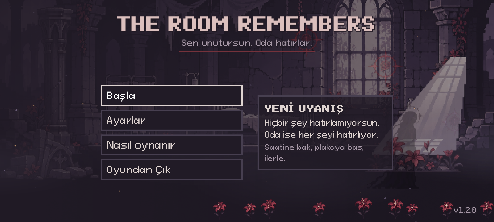
</p>

---

## 📖 Oyun Hakkında

> *"Gözlerin aralanır. Taş soğuk, tavan yüksek, adın yabancı. Sen öldüğünde hafızan sıfırlanır — fakat oda bıraktığın her bedeni, kırdığın her mührü ve verdiğin her sözü hatırlar."*

**THE ROOM REMEMBERS**, ölümün yenilgi değil, **dünyayı değiştiren bir bulmaca aracı** olduğu karanlık gotik bir 2D aksiyon-platform oyunudur. Yan görünüşlü, piksel sanatı bir yeraltı tesisinde geçer; hafızanın, lanetin ve bedenlerin oyunudur.

**Noroi** adını bilmeden, neden bu yıkık ve zamandan kopuk tesiste tutulduğunu bilmeden uyanır. Her ölümde o yaşamdaki hatıraları silinir, ama **oda hiçbir şeyi unutmaz**: öldüğün yerde bedenin kalır, açtığın kapılar açık kalır, çözdüğün bulmacalar çözülü kalır. Tesisi beyaz bir muhafız, **Shilda**, bekler; bedenlerinin başında yas tutar, onlara kızıl çiçekler bırakır. Duvarlardaki sayfalar ve kayıtlar ise çok daha eski iki geceye, **1927** ve **1995**'e işaret eder.

Altı bölgeyi (Uyanış, Çürüme, Kütüphane, Deney, Aynalar, Çekirdek) **47 oda** boyunca geçersin. Ana yol yaklaşık 65 dakika sürer; yan yollar, derin odalar, sınavlar ve gizli kayıtlarla tam bir oynayış yaklaşık **190 dakikadır**. Hikâye tek bir finalle biter: **BÖLÜM I SONU**.

**Ne yaparsın?**
* **Ölürsün ve bedenin kalır.** Cesetlerin platform olur, basınç plakalarına ağırlık verir, ışık taşır; plaka bulmacalarının çoğu bunu ister.
* **Yankıyı izlersin.** Yankı, geçmiş yaşamının tekrarıdır; bir sunağa kaydedip kendi kendinle iş birliği yaparsın.
* **Dövüşür ve süzülürsün.** 3'lü kılıç kombosu, Gölge Atılması (dash) ve Ruh Kesimi (soul slash).
* **Bulmaca çözersin.** Sıra bulmacaları, saksı ve ağırlık düzenekleri, aynalı yankılar, şifreli mühürler; her odada türetilebilir ipuçları vardır.
* **Laneti yönetirsin.** Diken ve ölüm laneti biriktirir; mühür noktaları onu emer.
* **Günlükle ilerlersin.** Günlükte ipuçları, harita ve sayaçlar (Kayıtlar 8, Sınavlar 6, Anılar 5) durur; Harita sekmesinde ziyaret ettiğin bir odaya dokunarak hızlı seyahat edersin. Kayıtlar 8/8 olunca **S.'nin Odası** açılır.
* **Oyunu ayarlarsın.** Müzik ve efekt sesi, yazı hızı, büyük yazı, ekran sarsıntısı ve ipucu seviyesi ayarlardan değişir.
* **Güncellenirsin.** Oyun açılışta resmî sürüm deposuna bakar; yeni sürüm varsa başlık ekranında "Güncelle" düğmesi görünür.

<details>
<summary>Teknik ayrıntılar: plaka kuralı ve bölge bulmacaları (geliştirici notları)</summary>

* **Oda geçitleri:** Taş söve, kapı kanatları, mühür ve eşik ışığı ayrı çizim katmanlarıdır. Kilitliyken hedef altında `Mühürlü` yazar. Açılınca ışık ve giriş komutu görünür. Karşı kapısı doğuşa yakın olan geçişlerde Noroi geldiği eşikten odanın içine bakar.
* **Oda derinliği:** Uzak duvar, orta dekor, ön dekor ve oynanabilir zemin ayrı düzlemlerde çizilir. Kemerler kendi duvar resminin parçasıdır. Bitkiler ve dekor, tavan ya da taş kaideleriyle hizalanır.
* Sera'da kemerler ve iki giriş aynı 1280 × 360 piksellik duvara oturur. Batıdaki pencerenin altında Ağırlık Salonu'na dönüş vardır. Doğudaki demir ızgara doğru saksının mührü çözülünce açılır. Yanındaki taş kapı Çatlak Duvar'a çıkar.
* **Sarnıç ve Kök Damarları:** Odaya özel taş hazne, sal ve vanalar su bulmacasının yüksekliğini gösterir. Su yüzeyi hareketli platformu izler. Rafların konsolları duvara bağlıdır. Sarnıç'ın dip sayfası su altında soluk görünür.
* **Canlı plaka kuralı:** plaka yalnızca taş/ceset ağırlığıyla basılır (oyuncu tek başına basamaz); kapı ağırlık durdukça açıktır, ağırlık kalkınca kapanır. Kapıdan karşı tarafa geçildiği anda bulmaca kalıcı çözülür (*geçiş kilidi*). Eski kayıtlarda çözülmüş bulmaca çözülü kalır.
* İstisna: `latch_on_press` plakası (yalnız Kripta `BedPlate`) basıldığı anda kalıcı çözülür; `accept_player` ve `latch_on_press` beyaz listesi `plate_rule_audit` ile denetlenir.
* Faz 2 odalar 07-10: Sarmaşık (çiçekli ceset `vine_gate`'i 64 px içinde yakar, `decay_vines`), Ağırlık (kapı `decay_weight_latch` VE yalnız-ceset `decay_weight_corpse` ister; eski kayıtta latch yeter), Sera (3 yalnız-ceset saksı plakası, görünür saksı çizimleriyle; doğrusu `decay_greenhouse_pot`; `greenhouse_shade` kara silueti doğru saksıda diz çöker, `WallInscription` 7-2-9 kaynağı; kapı geçişte eski `decay_greenhouse`'i de çözer), Shilda Duvarı (x200-480 lanet bulutu, düz yürüyüş ~%72 lanet, ceset kalkanıyla ~%10; `FlowerRoom` artık `echo_point`, `shilda_flowers_echo`; kapılar x1120/x1400; `WallThorn` ve yanlış saksı dikenleri kendi çözülmeyen ipucu id'siyle her zaman ölümcül, eski kayıtta çözülmüş oda günlükte ceset ipucu göstermez).
* **Son Merdiven (`core_ascent`) üç sınav:** soldan sağa Ruh Kesimi mührü (`core_ascent_seal`), 120 px yüksekliğinde Gölge Atılması perdesi (zıplayarak aşılamaz; zıplama tepesi ~58 px; boşluk yok, `core_ascent_gap` ID'si yalnız kayıt uyumu için), yankı plakası (`core_ascent_echo`: sunak + plaka + kapı). Ret repliği yeteneğin alındığı odayı adlandırır (Yasak Kanat, Ayna Tapınağı); `ascent_audit` denetler.
* **Metin ve veri tutarlılığı (Faz 0 T5):** Yankı Sunağı kayıt süresi her yerde sekiz saniyedir; Çiçeklenme bahçesi ipucu "önce en çok, sonra en az, sonra kalan"; Unutulmuş Sayfa ipucu deney, kapı, mühür sırasını verir; hücre çıkış kapısı `ForwardIntake`; kullanılmayan `core_portal.gd` kaldırıldı.
* **Ayna Tapınağı kapısı:** artık `mirrors_labyrinth` ileri kapısı (başlık "Ayna Tapınağı", nabız atan `DoorMark`); `door_audit` bunu denetler. (Eski: `mirrors_unbroken` yan kapısı.)

</details>

<p align="center">
  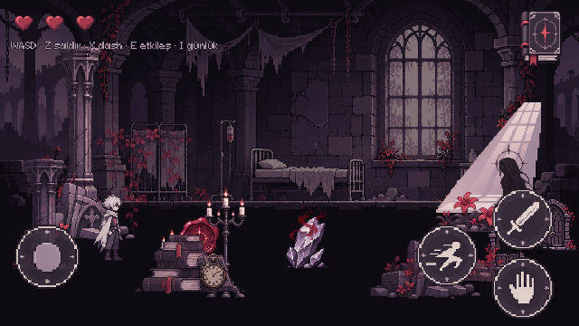
</p>

---

## 🏛️ Mimari ve Sistem Tasarımı

### 1. Üç Katmanlı Bellek ve Kalıcı Dünya Döngüsü (3-Layer Memory & Death Loop)

Oyun, ölüm anında neyin silinip neyin kalıcı olacağını katı bir mimariyle ayırır:

```mermaid
flowchart TD
    subgraph Oyuncu["🗡️ Noroi (Oyuncu)"]
        Life["Geçici Yaşam Belleği<br/>(character_current_life_knowledge)<br/>• Anlık diyalog bayrakları<br/>• Geçici oda etkileşimleri"]
        Curse["Lanet Seviyesi (%0 - %100)<br/>(CurseManager.curse)<br/>• Diken/Düşman/Ölümle artar"]
    end

    subgraph Olum["💀 Ölüm Anı (DeathManager)"]
        DeathEvent["Ölüm Tetiklenir<br/>(Diken / Uçurum / Hasar)"]
        SafeFloor["Son Güvenli Zemin Belirleme<br/>(_safe_floor_pos)"]
        CorpseDrop["Fiziksel Ceset Bırakılır<br/>(corpse.tscn)"]
    end

    subgraph Dunya["🏛️ Kalıcı Dünya (Oda Hatırlar — world_memory_state)"]
        Bodies["Kalıcı Fiziksel Bedenler<br/>• Basamak & Platform<br/>• Plaka Ağırlığı (Anchoring)<br/>• Lanet Süngeri<br/>• Yankı Tekrarı (Echo Replay)"]
        Puzzles["Kalıcı İlerleme<br/>• Açılan Gotik Kapılar<br/>• Kırılan Taş Duvarlar<br/>• Çözülen Bulmacalar (PuzzleManager)"]
        ShildaRel["Shilda Güven Mimarisi<br/>• Bedenlere Yas Çiçeği (Fener Ceset)<br/>• Koruyucu Kalkan (Ward)<br/>• Bölge Bazlı Evre Replikleri"]
    end

    subgraph Muhur["🕯️ Lanet Mühürleme Noktaları (MemorySealPoint)"]
        SealCheck{"Oyuncuda Lanet Var mı?<br/>(curse > 0.0)"}
        SealReject["Lanetsiz: Reddedilir<br/>'Kanımda aktif bir lanet yok...'"]
        SealAbsorb["Lanetli: Lanet Emilir (%0)<br/>+ Kalıcı Kayıt Yazılır (commit_save)<br/>+ Afiş: LANET MÜHÜRLENDİ"]
    end

    Life -->|Ölüm| DeathEvent
    DeathEvent --> SafeFloor --> CorpseDrop --> Bodies
    DeathEvent -->|+%25 Lanet Ekle| Curse
    DeathEvent -->|Oda İçi Güvenli Yeniden Doğuş| Life
    Bodies --> Dunya
    Puzzles --> Dunya
    Curse -->|Mühür Noktası Etkileşimi| SealCheck
    SealCheck -->|Hayır (<=0%)| SealReject
    SealCheck -->|Evet (>0%)| SealAbsorb
    SealAbsorb -->|Kayıt Mühre Kazınır| Dunya
```

---

### 2. Godot 4.7 Engine Sistem Mimarisi & Autoload Hub

Oyunun tüm alt sistemleri, 17 adet hafif ve otonom Autoload modülü üzerinden haberleşir:

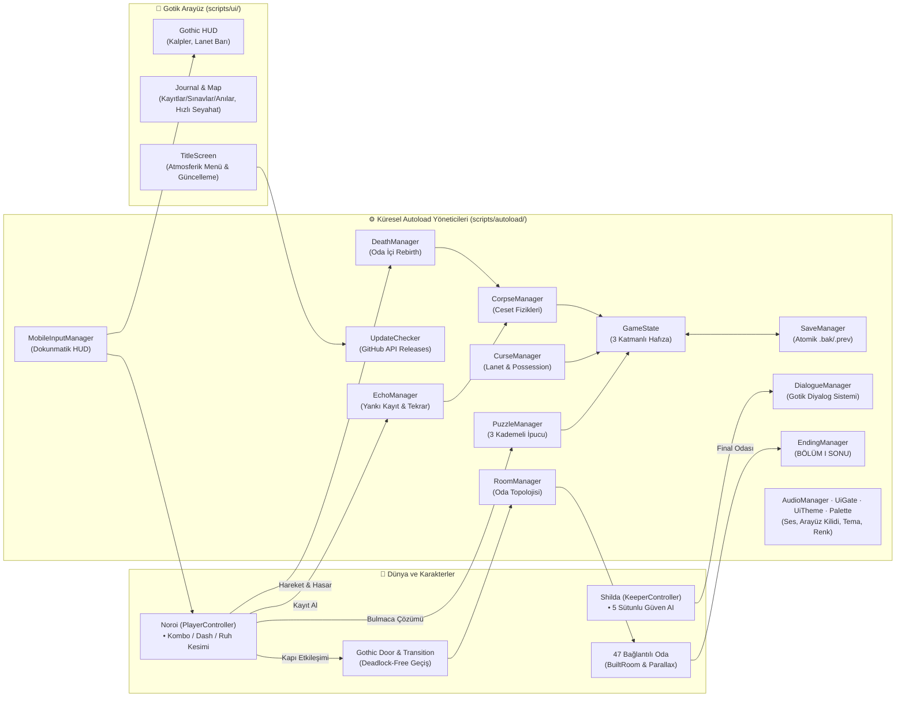

| Klasör | Rolü |
| :--- | :--- |
| `scripts/autoload/` | 17 global yönetici (`game_state`, `room_manager`, `death_manager`, `corpse_manager`, `curse_manager`, `echo_manager`, `puzzle_manager`, `dialogue_manager`, `dialogue_data`, `save_manager`, `ending_manager`, `mobile_input_manager`, `update_checker`, `audio_manager`, `ui_gate`, `ui_theme`, `palette`). `game_settings.gd` otomatik yüklenmez; ayarları saklayan statik sınıftır. |
| `scripts/player/`, `scripts/keeper/`, `scripts/camera/` | Noroi (`player_controller`, `soul_slash_wave`), Shilda (`keeper_controller`), takip kamerası. |
| `scripts/world/` | Oda bileşenleri: `built_room`, `room_transition`, `pressure_plate`, `corpse`, `echo_altar`, `echo_trial` (Yankı Sınavı), `memory_shrine` (Kırık Anı), `s_room_shrine`, `nook_record` (köşe Kayıtları), `dash_line`, `room_polish`, `room_touch` ve bulmaca parçaları. |
| `scripts/story/` | Kampanya hedefleri, final dizisi, ana hikâye odaları (`campaign_objectives`, `final_sequence`). |
| `scripts/ui/` | HUD, günlük (`journal_ui`, `journal_map`), başlık ekranı, oturum menüsü, bölge başlık kartı, mobil dokunmatik düğmeleri. |
| `scripts/dev/` | Headless denetimler ve yakalama araçları (aşağıdaki QA bölümü). |

Kayıt `SaveManager` ile atomik yazılır (`.bak`/`.prev` yedekleri). Defterin Harita sekmesindeki hızlı seyahat yalnız ziyaret edilmiş odalara izin verir. Güncelleme akışı: `update_checker.gd` açılışta public sürüm deposunun `releases/latest` yanıtını okur; `tag_name` oyunun `config/version` değerinden yüksekse başlık ekranında "Güncelle" düğmesi çıkar.

---

### 3. Dünya Atlası: 6 Bölge ve 47 Bağlı Oda

Tesis, birbirinden farklı görsel atmosfere, Gotik mimariye ve bulmaca dinamiklerine sahip 6 ana bölgeden oluşur:

```mermaid
flowchart LR
    Z1["🏛️ <b>Bölge I</b><br/>Uyanış Mahmuzu<br/><i>Awakening</i><br/>(Oda 01 - 06 · 41 · 47)"]
    Z2["🌿 <b>Bölge II</b><br/>Çürüme Bahçesi<br/><i>Decay</i><br/>(Oda 07 - 13 · 42)"]
    Z3["📚 <b>Bölge III</b><br/>Hafıza Kütüphanesi<br/><i>Library</i><br/>(Oda 14 - 20 · 43)"]
    Z4["⚗️ <b>Bölge IV</b><br/>Yasak Laboratuvar<br/><i>Experiment</i><br/>(Oda 21 - 27 · 44)"]
    Z5["🪞 <b>Bölge V</b><br/>Aynalar Salonu<br/><i>Mirrors</i><br/>(Oda 28 - 34 · 45)"]
    Z6["💠 <b>Bölge VI</b><br/>Bellek Çekirdeği<br/><i>Core</i><br/>(Oda 35 - 40 · 46)"]

    Z1 -->|Taş Bulmacası & Sağ Kapı| Z2
    Z2 -->|Arşiv Kapısı & Shilda Güveni| Z3
    Z3 -->|Ruh Kesimi (SoulSlash)| Z4
    Z4 -->|Karantina & Lanet Koridoru| Z5
    Z5 -->|Gölge Atılması & 729 Mührü| Z6
    Z6 -->|2 Mühür Parçası + Çekirdek Kristali| Final["🎬 <b>BÖLÜM I SONU</b><br/>(Tek Kanonik Final)"]
```

Oda numaraları `RoomManager.ROOM_ORDER` sırasını izler. İlk 40 oda ana omurgadır; 41-47 sonradan eklenen **derin odalar** ve **S.'nin Odası**dır:

| Oda | Başlık | Bölge |
| :---: | :--- | :--- |
| 41 | Sessiz Çanlar (`awakening_bellroom`) | Uyanış, derin oda |
| 42 | Kök Damarları (`decay_rootworks`) | Çürüme, derin oda |
| 43 | Kayıt Mahzeni (`library_archive_vault`) | Kütüphane, derin oda |
| 44 | İkiz Laboratuvarı (`experiment_twin_lab`) | Deney, derin oda |
| 45 | Ters Salon (`mirrors_inverse_hall`) | Aynalar, derin oda |
| 46 | Son Kayıt (`core_last_record`) | Çekirdek, derin oda |
| 47 | S.'nin Odası (`awakening_s_room`) | Gizli; Kayıtlar 8/8 ile açılır |

---

### Katakomb çiçeği ve Sarnıç (Faz 0)
Kemik Mahzeni girişinde (x≈150) tükenmez bir çiçek kaynağı durur. Çiçek elde ölürsen ceset çiçeği taşır ve fener gibi yanar; karanlık yol aydınlanır. Çiçek hayat başınadır, ölümde cesede geçer ve elden silinir. Sarnıç yan kapısı artık yetenek istemez.

### v1.20.1 (yayınlandı 2026-11-21, `versionCode 62`) — Ruh savaşı cilası ve uçtan uca test
- **Ruh toplama savaşı kesmez:** kıvılcım alınınca modal diyalog yerine kıvılcımın üstünde yükselip sönen "Ruh serbest · +%10 Berraklık" yazısı (`soul_spark._float_label`); oyun akışı durmaz.
- **Ölümde düşman sıfırlanır:** oyuncu ölünce yarım kalan telegraph/saldırı sıfırlanır, yeniden doğuşta düşman anında vurmaz (`soul_enemy._on_player_death`).
- **Raf köprüsü uyarısı giderildi:** `sequence_shrine._spawn_bridge` ekleme/yapılandırma ertelendi ("parent busy" uyarısı yok).
- **Yeni denetim:** `scripts/dev/soul_e2e_audit.gd` (152 kontrol) — gerçek kılıç vuruşuyla 9 düşman, denge tablosu, kıvılcım/zaman aşımı, ölüm/kayıt kalıcılığı, iki final hükmü gerçek diyalogda, UI açıkken düşman donması. Yakın dövüş öldürmesi kıvılcımı otomatik toplar (tasarım kararı, korunur).

### v1.20.0 (yayınlandı 2026-11-21, `versionCode 61`) — Parçalanmış Ruhlar: savaş ve ruh toplama
- **Düşmanlar** (`scripts/world/soul_enemy.gd`, gruplar `soul_enemy` + `enemy`; hepsi 1 kalp verir, `UiGate.pauses_world_threats()` ve ölüm sırasında durur, i-frame'de hasar vermez):
  - **Sürünen** (crawler, 2 can): yavaş yürür, ~0.55 sn uyarıdan sonra kısa atılma yapar.
  - **Fısıltı** (whisper, 1 can): mesafe korur, ~0.8 sn uyarıdan sonra yavaş mor mermi atar (`soul_projectile.gd`); zıplayarak/atılarak aşılır, tek kılıç vuruşunda ölür.
  - **Kopuk Bekçi** (warden, 3 can): önden kalkanlıdır (kılıç sekmeler); yalnız arkadan (atılarak arkasına geç) veya saldırı sonrası toparlanma anında yaralanır; ağır, ~0.75 sn uyarılı saldırı.
- **Ruh kıvılcımı** (`soul_spark.gd`): ölen düşman kıvılcım düşürür; dokunmak ruhu serbest bırakır ve `CurseManager.clear_curse(10)` uygular. ~5 sn içinde alınmazsa kıvılcım söner, ruh geri döner ve düşman evinde yeniden belirir.
- **Kalıcı defter** (`scripts/autoload/soul_manager.gd`, `GameState.world_memory_state["souls"]["collected"]`): ölüm ve yeniden yüklemeyle silinmez; eski kayıtlar boş defterle göç eder (`save_manager._deserialize_world`). Toplanan ruhun düşmanı bir daha doğmaz (`room_manager.enter_room` -> `SoulManager.ensure_room`).
- **Yerleşim (9 ruh, 4 oda):** Hafıza Kütüphanesi (Sürünen, Fısıltı), Üst Raflar (Sürünen, Bekçi), Karantina Mahzeni (Sürünen, Bekçi, Fısıltı), Gözlem Camı (Sürünen, Fısıltı). Hafıza mührüne >=160 px, plakalara/boşluklara uzak.
- **HUD:** sol üstte "Ruhlar oda (toplam)" sayacı (ruhsuz odada gizli; dokunmatik kontrollerle çakışmaz, `touch_controls_layout_audit` kapsar). **Günlük:** "Parçalanmış Ruhlar x/9" notu, oda başına durum.
- **Final:** Shilda hepsi toplandıysa "Hepsini getirdin. Senden önce gelenler artık gidebilir.", değilse "Hepsini getirmedin. Kalanlar bu odalarda sonsuza dek dolaşacak." der (`final_sequence._souls_verdict`).
- **Denetim:** `scripts/dev/soul_combat_audit.gd` (Run-Audit.ps1 listesinde `soul_combat`). Gerçek ana sahne uçtan uca testi: `scripts/dev/soul_e2e_audit.gd` (`soul_e2e`): bot kılıç saldırısı, denge tablosu, kıvılcım/zaman aşımı, ölüm+kayıt, final hükmü. Oyuncu ölünce düşmanların yarım kalan saldırısı sıfırlanır.

### v1.19.5 (yayınlandı 2026-11-21, `versionCode 60`) — Sera kapısı oyun içinde açılır, lanet ekonomisi
- **Sera kapısı:** `gate_blocker` artık kendi kendini onarır: her fizik karesinde gerçek kapı durumu (`_is_open()`) ile görünürlük/çarpışma karşılaştırılır, sapma varsa düzeltilir; `rebirth_completed` ve `game_loaded` sonrası yenilenir, legacy/also_solve id'leri de dinlenir. Diken ölümünde çözülen bulmaca hemen kaydedilir. Audit: `greenhouse_gate_visually_open_after_death`, `greenhouse_gate_self_heals`.
- **Lanet ekonomisi:** ölüm laneti **0'a sıfırlar** (eskiden +25, taban 50). Lanet savaş ve yetenekle artar: kılıç savurma +1.5, atılma +3, gölge atılma +4 (`player_controller.gd` `CURSE_PER_*`).
- **Lanetli yürüyüş:** laneti yüksekken takılma/yavaşlama kaldırıldı; lanet yalnız görsel/ses uyarısıdır.
- **Kararma:** lanet ekran tonu (`curse_vfx.gd`) gerçek değeri yavaşça izler (~6/sn artış, ~12/sn azalış); ani kararma yok.

### v1.19.4 (yayınlandı 2026-11-21, `versionCode 59`) — Sera kapısı, dokunmatik kontroller, oda taraması
- **Sera (oda 09) kapısı:** telefonda orta saksının dikeninde ölünce kapı açılmıyordu (plaka fiziği cesedi kaçırabiliyordu). `blood_thorn.gd` yeni `solve_on_death` alanı: doğru dikende bilerek ölmek bulmacayı doğrudan çözer, kapı kalıcı açılır. Aynı yedek tek bedenli 15 odaya daha eklendi (Uyanış, Sessiz Çanlar, İlk Bedenler Mahzeni, S.'nin Odası, Çiçek Bahçesi, Son Kayıt, Sarnıç, Kök Damarları, Ağırlık Salonu, İki Yankı, Kabul Odası, Gözlem Camı, İkiz Laboratuvarı, Kayıt Mahzeni, Üç Tanık). Çok bedenli/köprü/yem dikenleri değişmedi.
- **Dokunmatik kontroller:** Zıpla en büyük (76) sağ alt köşede, Etkileşim hemen solunda, Saldırı/Atılma/Yetenek üstte yay şeklinde; joystick kenardan içeri alındı; konuşmada yalnız Etkileşim köşede. Yeni `touch_controls_layout_audit.gd` (4 çözünürlük × 5 buton boyutu, 0 FAIL).
- **Metinler:** dikenli ipuçları "iki kez dokun" olarak düzeltildi (Sera, Ağırlık Salonu, Bedenler Galerisi).

### v1.19.3 (yayınlandı 2026-11-19, `versionCode 58`) — kaydırırken ayar değişmesi düzeltildi
- **Kaydırma butona basmaz:** v1.19.2'de sürüklemeye bir butonun üstünden başlayınca (ör. Ses) parmak kalkınca ayar yine değişiyordu; BaseButton "içeride basılı" durumunu yalnız fare hareketiyle güncellediği için uzak sahte bırakma basma sayılıyordu. `_cancel_button_press` önce dışarıya sahte hareket, sonra bırakma gönderir. Telefonda (adb) doğrulandı: iki yönde kayar, ayar değişmez, tek dokunuş çalışır.
- **BUG-022 kapandı:** "Gölge olmadan önce" kanonla uyumlu (Shilda Gölge'nin kendisi; insanken Araştırma Yardımcısı S.); "Güvenlik görevlisi" satırı kodda yok.

### v1.19.2 (yayınlandı 2026-11-19, `versionCode 57`) — telefonda ayarlar kaydırma
- **Ayarlar parmakla kayar:** gerçek telefonda (Xiaomi, adb) liste butonların üstünden sürüklenince kaymıyordu; dokunuşu buton yutuyordu. `title_screen.gd` `_input` sürüklemeyi kendisi kaydırır (6 px eşik), kaydırma başlayınca basılı buton uzak bir sahte bırakmayla iptal edilir, yani kaydırırken ayar değişmez. Dokunmatikte Ayarlar en üstten açılır ("nasıl oynanır" metni görünür; önceden odak Ses düğmesine kaydırıyordu).

### v1.19.1 (yayınlandı 2026-11-19, `versionCode 56`) — geçilemeyen odalar, etkileşim seçici, yankı plakası, ayarlar, jenerik
- **Etkileşim seçici:** iki veya daha fazla etkileşim cismi üst üste gelince ekranın kenarında küçük bir liste çıkar (`▸ El · etiket`). El düğmesi seçili olanı kullanır; listedeki satıra dokunmak doğrudan onu seçer ve kullanır; klavyede Tab ile sırayla değişir. Liste oyun alanını örtmez, tek hedef varken görünmez (`player_controller.gd` `get_interaction_candidates` / `choose_interaction` / `cycle_interaction`, `hud_controller.gd` InteractChooser). İşe yaramayan hedefler (`can_interact() == false`) listeye girmez.
- **Sera (oda 09) geçilir:** fazla ceset temizliği (`corpse_manager.gd` `_trim_excess`) doğru saksıdaki en yeni bedeni siliyordu. En yeni ceset artık hiç silinmez; daha yeni bir cesedin de tuttuğu plakadaki eski ceset "tutuyor" sayılmaz.
- **Sarnıç (oda 13) geçilir:** dipteki sayfa ortadaki vananın tam altındaydı ve El hep vanayı seçiyordu (dipteyken "Vana ↓" hiçbir şey yapmaz). Sınırdaki vana artık hedef olmaz (`valve.gd` `can_interact`), etiket `Vana ↑/↓`.
- **Kemik Mahzeni ikinci boşluk kolaylaştı:** köprü bedeninin altına 80 px kemik kalas eklendi (`blood_thorn.gd` `bridge_plank_width`, yalnız köprü cesedi varken var). İki yarım zıplamanın payı ~0 px'ten ~42 px'e çıktı; boşluk tek zıplamayla hâlâ geçilemez (264 > 250).
- **Yankı plakaları görünür:** `echo_switch.gd` plaka görseli zemin şeridinin (z 2) altında kalıyordu; artık diğer basınç plakalarıyla aynı yükseklikte (`sprite y -22`). Oda 41 "Sessiz Çanlar"da üç plaka da görünür; aynı düzeltme yankı plakası kullanan tüm odalara (S.'nin Odası, Son Kayıt, İkiz Laboratuvarı, Arşiv Kasası, Tanık, Devre, Çift Ayna) uygulanır. Çift Ayna plakası zemine hizalandı (y 20→32).
- **Ayarlar kaydırılabilir:** başlık ekranı Ayarlar sayfası `SettingsScroll` içinde; alttaki seçeneklere kaydırılarak/odakla inilir, "< Geri" düğmesi sabit kalır.
- **Jenerik:** "Tasarım ve Kod" kredisi artık **Torimon**.

### v1.19.0 (yayınlandı 2026-11-18, `versionCode 55`) — okunabilirlik ve softlock turu
- **Sera (oda 09):** üç saksı artık görünür (x460/620/780). Noroi'nin kara silueti oyuncuyu beklemeden orta saksıya yürür, başında diz çöker ve saksı parlar; gösteri döngüyle tekrarlanır (`greenhouse_shade.gd`). Dikenler kendi saksılarının yanında; not objeleri (cam yazısı, mühür) saksıya benzemez. Toprak izi yalnız gölgenin diz çöktüğü saksıda.
- **İniş işareti:** her `blood_thorn` cesedin düşeceği yere (`anchor_x`) soluk kırmızı bir yer işareti çizer; diken uzaksa arada noktalı çizgi. Bulmaca çözülünce kaybolur.
- **Katakomb:** iki ek diken (`ThornLeft` x374 → ceset 300 / sembol 5, `ThornMid` x568 → ceset 600 / sembol 8); köprü dikeni 725 → 898. Üç çiçekli ceset (sol, orta, köprü) artık üretilebilir. Köşe kaydı `NookRecord` 570→1050 (mühür/diken boşluk kuralları).
- **Gölgeler/yankılar:** vigil sahte gölgeleri uzakta, soluk ve titrek; gerçek gölge kapıya kadar yürür. Okuma hücresi gölgesi kapıya ulaşır. Gözlem yankısı oyuncuyu beklemez. `path_mimic` kontrol noktaları soluk halka olarak görünür.
- **Metin:** tek dikenli odalarda "Dikende öl"; karantina ipucu "Sise gir, lanetten öl"; bahçe dikeni cesedin düştüğü yere yaklaştırıldı (400→570), Kök Damarları yan kapısı 500→460.
- **Hedef:** Sera hedefi "Gölgenin diz çöktüğü saksının dikeninde öl; camdaki yazıyı oku."
- Denetim: phase2 `greenhouse_shade_walks_alone_and_kneels_at_right_pot`, `greenhouse_thorns_sit_on_their_pots`, `greenhouse_three_visible_planters_even_when_solved`; polish "wrong pot leaves no mark".

### v1.18.6 (yayınlandı 2026-11-17, `versionCode 54`) — Türkçe metin cilası, mobil yerleşim, kararlılık

- **Günlük Türkçe:** bütün diyalog JSON'ları, oda sahnelerindeki tabela/ipucu metinleri ve arayüz yazıları doğal konuşma diliyle yeniden yazıldı. Bulmaca sayıları, lore kanonu ve satır sayıları korundu.
- **Mobil yerleşim:** hedef satırı kalplerin altında; Etkileş düğmesi diyalog kutusuna binmiyor; seçim kutusu ekrana sığıyor ve sola hizalı; Menü düğmesi çentik payına uyuyor; ayarlar paneli kaydırılabiliyor; uzun konuşmacı adları ("Araştırma Yardımcısı S.") artık kesilmiyor.
- **Kararlılık:** kapı geçişi ya da Ruh Kesimi sırasında uygulama arka plana atılırsa kayıt bekletilir ve iş bitince yazılır (2 sn debounce). Hızlı seyahat ve kapı geçişinde ölüm yarışı giderildi (`_abort_travel`). Yankı sunağı kaydı ölümde iptal ediliyor. Ceset yankısı yüklemeden sonra tekrar oynamıyor. Yetim `HINTS[decay_catacombs]` silindi. Hedef metni genişliği yalnızca ekran boyutu değişince hesaplanıyor.
- **Oyuncu dostu yenilikler:**
  - Ayarlarda **Buton boyutu** (%80–%120). Düğmeler köşeye sabitlenir; Etkileş diyalog kutusuna, Atıl bağlam ipucuna binmez.
  - **Titreşim** 4 seviyeli (Kapalı/Hafif/Normal/Güçlü). Hasarda, ölümde ve bulmaca çözülünce kendi deseniyle titrer. Eski açık/kapalı ayarı Normal/Kapalı'ya taşınır.
  - **İlk dokunuş rehberi:** joystick ve düğme etiketleri ilk hareketten sonra ya da 6 sn sonra kaybolur, bir daha çıkmaz.
  - **Hedef nabzı:** hedef değişince satır hafifçe parlar ve kısa titreşir.
  - **Takılma yardımı:** aynı odada 3 kez ölünce "Takıldın mı? Küçük bir ipucu:" ile yön gösteren bir ipucu çıkar.
  - **Geri tuşu ipucu:** toplamda en fazla 2 kez gösterilir.
  - **Bildirim kuyruğu (`queue_toast`):** ölüm sinematiği ya da diyalog açıkken bekler. Sınır yüzünden en eski ceset silinince "En eski bedenin toprağa karıştı." der; yükleme sonrası yarım kalan düzenek için "Bu odadaki düzenek sıfırlandı." der.
  - **Günlük rozeti:** yeni kayıt gelince Günlük düğmesinde kırmızı nokta, ilgili sekmede "•" çıkar; görülen sayı kayıtla saklanır.
  - **Devam kartı:** son kaydın yanında oynama süresi ("Süre") ve son günlük notu da gösterilir (`play_time_sec`, eski kayıtta 0).
  - **Ortam anları:** 6 yürüyüş odasında (Karantina, Yetki Masası, Devre, Sayfa, Nöbet, Shilda Duvarı) oda ortasında ziyaret başına bir kez kısa bir ses ve fısıltı çıkar (`scripts/world/room_ambient.gd`).
  - **Hızlı seyahat ipucu:** görülmüş 3 odadan üst üste geçince bir kez çıkar.
  - **Kapı etiketleri** artık dokunmatik düğmelerin ve joystick'in altında kalmaz; yukarı ya da yana kayar (`hud.get_touch_button_screen_rects()`).
- **Eski denetimler onarıldı:** m1/m2/m3 milestone denetimlerinin (9 adet) hepsi 0 FAIL. 4 bayat beklenti güncellendi: plaka konumu sahneden okunuyor, lanet 99 tavanı, cilalı mühür metni, kaldırılmış yan kapılar. Gerçek hata olarak Sarmaşıklar odasında `Step_b` yan kapıya 104 px kalıyordu; 1020'ye taşındı (`Step_c` 1060). Bu denetimler `Run-Audit.ps1` içinde `$legacyDevAudits` olarak koşuyor. Yeni `feedback_audit` paketin içinde.
- **Testler:** yeni `mobile_layout_audit` (8 çözünürlük × normal/büyük yazı × ~80 px çentik, 2080 kontrol) ve `mobile_capture`. e2e S.'nin Odası testi eklendi (7 Kayıt'la kilitli, 8 Kayıt'la açık). fast_travel_audit'e 14 test eklendi. door_controls rotaları güncellendi. `plate_rule_audit` derin oda plakalarını (latch_on_live kapı) tanıyor. Mühürle çakışan iki etkileşim taşındı: Kütüphane Salonu `NookRecord` (x 140) ve Deney Hücreleri `WallNotches` (x 402).

### v1.18.5 (yayınlandı 2026-11-17, versionCode 53) — günlük yerleşim düzeltmesi

Günlükteki Harita & Mühürler sekmesinde üst üste binen yazılar giderildi: başlık satırları (Mühür, Kanıt, Kısayol, Kayıt/Sınav/Anı sayaçları) yazı tipi ölçüsüne göre diziliyor, "Odaya dokun: hızlı git" ipucu sağ sayfaya taşındı, kısayol çizgisi yalnız kartların arasında çiziliyor, uzun bölge başlıkları küçülüyor ve çift haneli ceset sayısı oda dairesine sığıyor. İzler sekmesinde sayaçlar ayrı satırda. Yeni denetim: `journal_layout_audit`.

### v1.18.4 (yayınlandı 2026-11-16, versionCode 52) — 6 derin oda, 8 köşe, 6 Yankı Sınavı, Kırık Anı, S.'nin Odası, metin cilası
- Tüm diyalog, oda ve script metinleri Türkçe dil/ton/tekrar açısından elden geçirildi (44 dosya). Aynalı Zemin açık ipucu düzeltildi: kırmızı şeritlere basılmaz.
- Eleştiri ve öneri raporu: `docs/gelistirme/oyun-elestiri-ve-oneriler-2026-11-15.md`.
- Ayarlar: ayrı Müzik/Efekt sesi, metin hızı, ekran sarsıntısı, yazı boyutu, ipucu seviyesi (`scripts/autoload/game_settings.gd`, `user://settings.cfg`).
- Hikâye: Shilda'nın Güven ve Acı fazları dolduruldu (diyalog ~440→700 satır; 1927 gecesi, Denek 14, okuma hücresi, kırılmamış ayna yüzleşmesi).
- Zayıf odalar: Çekirdek girişine yankı-kapı bulmacası; sarmaşık, sarnıç, geçit, sayfa, ters ayna, hücre, okuma odası ve yüzleşme sahnelerine ipucu/hikâye satırları.
- 6 derin bulmaca odası (yan kapıdan, isteğe bağlı, ödüllü): Sessiz Çanlar, Kök Damarları, Kayıt Mahzeni, İkiz Laboratuvarı, Ters Salon, Son Kayıt. Her biri ceset/yankı/kesim/atılma gibi en az üç mekaniği birleştirir; sıra ipucu odadaki üç kayıttan toplanır. Oda sayısı 46.
- 8 geri dönüş köşesi: eski odalarda Ruh Kesimi (mor damar) veya Gölge Atılması (kırmızı çizgi) ile açılan küçük alanlar; iki parçalı kayıtlar Araştırma Yardımcısı S.'nin 1927 öncesini anlatır. Defterde "Kayıtlar N/8" sayacı.
- Yankı Sınavı (6): derin oda çözülünce odadaki sunak 60–90 sn'lik zamanlı bir varyant açar (farklı sıra, plakada bekleme, yanlış adımda süre cezası). Başarısızlık cezasızdır; başarı defter sayfası verir. Defterde "Sınavlar N/6" sayacı. Ana ilerlemeye sayılmaz.
- Ses/ışık cilası: bulmaca tipine göre ayrı çözüm sesleri; 9 odada küçük ortam dokunuşları (`room_touch.gd`).
- Sınav çeşitlemeleri: Sessiz Çanlar'da çanlar çalarken plaka basılı kalmalı, Kayıt Mahzeni'nde kadran sınav kaydındaki yıla ayarlanmalı, Ters Salon'da kırmızı şerit kestirmeyi kapatır (atılma gerekir), Son Kayıt'ta bir adım önce Ruh Kesimi ister.
- Görsel cila (`room_polish.gd`, 7 oda): bahçede taç sayısı kadar ışık noktası, serada toprak izi, galeride camda yüzler ve "Beden: N", 1927'de camın ardında X silueti, tapınakta bir adım önden yürüyen gölge, balkonda dürbün vinyeti, anı kasasında yıl parıltıları.
- Kırık Anı (5): her bölümün sakin bir odasında Shilda'nın insan hâlinden üç parça; tarih ve sebep-sonuç ipuçlarıyla doğru sıraya dizilir (İlk Gün, Sera, Yasak Raf, Yanlış Sayı, Geç Yansıma). Yanlış sıra cezasız; ödül defter kaydı + Shilda satırı. Defterde "Anılar N/5".
- S.'nin Odası (oda 47, Uyanış'tan yan kapı): 8 köşe kaydı toplanınca açılır. Ceset+diken+plaka, yankı sunağı, ruh kesimi mührü ve lanet şeridinin üstünden atılma birleşir; son sıra Kırık Anı başlıklarının kronolojisidir. Ödül: "Epilog: S.'nin Defteri" ve kısa bir Shilda/Noroi konuşması. Oda sayısı 47; tahmini süre ~190 dk.

### v1.18.3 (yayınlandı 2026-11-15, versionCode 51) — Defterden hızlı seyahat
- Defter → Harita sekmesinde daha önce girilmiş bir odaya dokun: oda seçilir, üstte adı ve "Gitmek için tekrar dokun" çıkar. Aynı odaya tekrar dokununca defter kapanır, ekran kararır ve oda girişinde doğarsın.
- Engeller (kırmızı uyarı): bulunduğun oda, hiç görmediğin oda, kapı geçişi sürerken, ölürken ve kristal savunması aktifken gidilmez. Defter zaten yalnız serbest oyunda açıldığı için diyalog/sinematik/final sırasında çalışmaz.
- Kod: `RoomManager.fast_travel_block_reason()` / `fast_travel()`, `JournalMap.travel_requested`, `DoorScript.begin_transition_lock()`. Denetim: `scripts/dev/fast_travel_audit.gd` (14 kontrol).

### v1.18.2 (yayınlandı 2026-11-15, versionCode 50) — Sera (oda 09) kapı düzeltmesi
- Orta saksıya (PotB) ceset düşünce `ExitGate` artık geçiş beklemeden `decay_greenhouse_pot` + `decay_greenhouse`'u kalıcı çözer (`gate_blocker.latch_on_live`). Ceset sonradan alınsa da kapı ve sağ çıkış (x=1240) açık kalır; plakada ceset olan eski kayıtlar odaya girince onarılır.
- `blood_thorn`: `anchor_y` verilmese de beden her zaman `anchor_x`'e düşer (son güvenli zemin yüksekliğinde).
- Denetim: phase2 `greenhouse_right_pot_latches_without_crossing`, `greenhouse_gate_stays_open_after_corpse_removed`, `greenhouse_real_thorn_death_opens_gate`/`_unlocks_exit` (gerçek diken yolu, iki başlangıç konumu).

### v1.18.1 (yayınlandı 2026-11-14, versionCode 49) — ipucu/mantık düzeltmeleri
- 40 oda denetlendi; şifre/sıra ipuçları oyuncu metninden türetilebilir hale getirildi (kütüphane 251, 3-9-6; katakomb 586; deney 418 vb.). Oda 16 eski kayıt kapı kilidi `dial_puzzle._heal_also_solve()` ile onarılır. Yeni denetim: `scripts/dev/clue_solvability_audit.gd`.

### Bölüm V–VI odaları (v1.18.0, yayınlandı 2026-11-14) — Faz 4 bulmaca yeniden tasarımı
- **Doğrusal ana yol (oda 28–40):** mirrors_reverse → dual → gallery → unbroken → labyrinth → shrine → 1927 → core_threshold → core_ascent → core_seal_chamber → core_memory_vault → core_bloom_garden → core. Labirent, tapınak, 1927, kasa ve bahçe artık zorunlu ana yoldadır; `SIDE_DOORS` yalnız awakening/decay odalarında kalır. İleri kapı hedefte `from_<önceki_oda>`, geri kapı `from_<sonraki_oda>` doğar.
- **Bulmacalar:** Ayna Geçidi'nde ters kontrol bölgesi (`control_invert`); İki Yankı'da aynalı yankı + ceset ağırlık plakası; Bedenler Galerisi'nde üç latch plaka (üç beden sırayla); Kırılmayan Ayna'da yankı yol taklidi (`path_mimic`); Labirent'te ceset köprüsü ve kalkanlı gölge; Tapınak'ta Gölge Atılması sınavı (oda 33'te kazanılır); 1927'de sessiz gece yürüyüşü, tarih tuğlası ve X'in adı; Eşik'te lanet bulutu koridoru + ceset kalkanı; Mühür Odası'nda üç sıralı `soul_seal` bağı; Kasa kodu 1927 → 1995 → Son (önceki odalardaki kayıtlardan çıkar); Bahçe sırası 4-1-2 (taçlardaki çiçek sayısı).
- **Yeni bileşenler:** `control_invert` bölgesi (`player.invert_x`, oda çıkışı/ölümde sıfırlanır), `path_mimic`, `echo_altar.mirror_axis_x`, `echo_twin.set_mirror`, `reach_marker.also_solve`, `sequence_shrine.require_live`, `night_walk`, `core_defense`, `built_room` kapı `title/mark/label_dy`. `trusted_keeper` yalnız bahçedeki Uzlaşma noktasında, `truth_seen` yalnız kasanın son anı sahnesinde yazılır.
- **Final varyantları:** kristal savunması 3 dalga (2/3/4 gölge, kristal 5 can) sonrası tek final (`BÖLÜM I SONU`). `trusted_keeper` ve `truth_seen` açıksa `together` (`final_together` bayrağı), değilse `apart`; yalnız kapanış bloğu değişir.
- **Eski kayıt güvencesi:** v1.17 kayıtları yüklemede labirent/tapınak/1927/kasa/bahçe kimliklerini, Gölge Atılması'nı alır; güven bayrakları tek seferlik temizlenir (`migrated_v118`). Denetim: `phase4_rooms_audit._softlock()` (a–e senaryoları) ve `_main_path_walk()` (f: kapı grafiğiyle 40 oda erişilebilir, core'a varılır, savunma tamamlanır).
- **Final cilası:** savunma bitince bekçi "Kristal sustu. Şimdi dokun, mührü birlikte kıralım." der ve mühür sesi çalar; hedef metni ikinci dokunuşu söyler; mühür odası kapı mesajı bağlar kesildikten sonra da tutarlıdır.
- **Silinen dosyalar:** `scripts/world/mirror_relay.gd` ve `scripts/world/archive_door.gd` (kullanılmıyordu; `dialogue_data_audit` `mirror_relay_gone`/`archive_door_gone`), `core_portal.gd` Faz 0'da silinmişti. Sürüm: `project.godot` 1.18.0, `version/code` 48, yayınlanmadı.

### Bölüm III–IV odaları (v1.17.0, hazır, yayınlanmadı) — Faz 3 bulmaca yeniden tasarımı
- **Doğrusal ana yol (oda 14–27):** library_hall → witness → clockroom → page → upper_stacks → forbidden_wing → reading_cell → experiment_cells → intake → circuit → authority → quarantine → core_conduit → observation → mirrors_reverse. Her odanın ileri kapısı kendi bulmacasına bağlıdır; yan kapılar ve geri dönüş korunur.
- **Yeni bulmacalar:** Hall'da üç kitap raf sırasıyla çekilir; Tanıklar'da saat/çiçek/mühür yankıları, yalnız-ceset plakası ve yankı sunağıyla 251; Saatler Odası'nda üç kadran (3-9-6); Üst Raflar raf sırası; Yasak Kanat'ta iki mor mühür sırayla; Okuma Hücresi mor mühür kabini ve okuyucu gölgesi; hücre kapılarında üç ceset plakası; Kabul odasında terazi (ceset + taş); Yetki masası 418; Karantina'da lanet bulutu ve ceset kalkanı; Çekirdek Kanalı'nda Ruh Kesimi ile üç damar sırayla; Gözlem'de ceset projektör plakası ve yürüyen yankı.
- **Yeni bileşenler:** `dial_puzzle` (kadran 1..12, `targets`, `also_solve`), `soul_seal` (`requires`, `blocking`, `wrong_line`), `echo_altar.live_only`, `trace_shade` kullanımı (okuyucu gölgesi), `gate_blocker` ile `also_solve` kapıları; damarlar `receive_soul_slash` ile kesilir.
- **Eski kayıt güvencesi:** yeni bulmacalar eski id'leri de çözülü işaretler, kapılar eski id'leri dinler; yükleme göçleri Ruh Kesimi'ni ve raf sırasını geç odalar için verir.
- **Faz 3 final düzeltmeleri:** v1.16 kaydı geri dönüşte kilitli kapı görmez (`SaveManager._migrate_side_room_puzzles_for_late_rooms`: Yasak Kanat, Okuma Hücresi, hücreler, Karantina, Damarlar, Gözlem Camı çözümleri oda sırasına göre işaretlenir; audit 14 odayı gezer). `observation_echo` diyalog bağlantısını üyede tutar, `_exit_tree` çözer, tamamlanma `dialogue_finished(true)` ile. Üst Raflar ipucu yere düşen kitabı gösterir; hücre C Shilda ön-ifşası kaldırıldı; hücre kalkanlı gölge x=790; Tanıklar bekçi konumu x=540.
- **Softlock denetimi:** `phase3_rooms_audit._softlock()` — v1.16 tarzı kayıt, hücrelerde ceset sınırı, 14–27 yeniden giriş, kanalda yanlış sıra. Hafıza mühürleri (çürüme bahçesi, kütüphane, uyanış mahzeni) etkileşim nesnelerinden uzaklaştırıldı. Sürüm: `project.godot` 1.17.0, `version/code` 47, yayınlanmadı.

### Bölüm I–II odaları (v1.16.0) — Faz 2 bulmaca yeniden tasarımı
- **Yeni bulmacalar (oda 01–13):** Uyanış Odası ceset plakası + dikenli kök; Gözlem Balkonu'nda ceset basamağı; Kırık Geçit'te 3-1-4 halka sırası; Mühür Odası'nda iki plaka (iki ayrı beden); Sarmaşık, Ağırlık, Sera, Shilda Duvarı yeniden kuruldu; Bahçe'de 7-2-9 çiçek sırası; Katakomb çiçek kaynağı; Sarnıç'ta tahliye plakası ve su seviyesi.
- **Yeni bileşenler:** `gate_blocker` (bulmaca çözülene kadar geçit kapalı), `sequence_shrine` (sıralı dokunuş, yanlışta sıfırlama), `hidden_symbol` (ışıkta okunan işaret), `water_level` + `valve` (su seviyesi, tahliye bağlantısı), `choice/ask` (`DialogueManager.ask`, seçimli diyalog; şimdilik yalnız Shilda nöbeti), `PuzzleManager.LEGACY_ROOM_DONE` (eski kayıtlardaki çözümler yeni bulmaca kimliklerine taşınır).
- **Softlock güvencesi:** `phase2_rooms_audit` `_softlock()` — v1.15 kaydında 01–13 ana yol kapıları açık, mühür plakası boşaltılıp yeniden doldurulabilir, Sarnıç'ta tahliye boşken seviye 0'a inilemez ve ceset yeniden konabilir, çözülmüş odaya dönüşte kapılar açık ve nöbet sorusu tekrar sorulmaz. Kayıttan doğrudan Sarnıç'a devam edince su seviyesi sıfırlanır.
- **Düzeltmeler:** gizli odaların diken/lanet bulutları oyuncuya sayılmıyor (`_near_hazard`); eski kayıtta geçit halkaları mühür çözülmüşse çözülmüş sayılır.
- **Final review düzeltmeleri:** Kırık Geçit doğuş noktası x=600 (çatlağa 109 px); mühür plakası 4. ölümde gerçek `_trim_excess` ile plaka cesetlerini korur; taze kayıtta halka bulmacası kendiliğinden çözülmez (negatif test); eski kayıt taraması yan kapı + yeni kapı kimlikleri + v1.15 dünya bayraklarını kapsar; ipuçları 70 karakter sınırında, `LEGACY_ROOM_DONE` Uyanış geçit/mühür ve Katakomb için genişledi.
- **Playtest:** oda başına süre otomatik ölçülmez; kullanıcı ölçer (spec §10). Sürüm: `project.godot` 1.16.0, `version/code` 46, yayınlanmadı.

### v1.15.0 (hazır, yayınlanmadı) — Faz 1 diyalog yeniden yazımı
- **Kapsam:** tüm oda, Shilda/Gölge, sistem ve arayüz metinleri sade Türkçeye yeniden yazıldı (T3–T6). Oda/puzzle/flag/relic ID'leri, `when` koşulları, bulmaca çözümleri değişmedi. Sürüm: `project.godot` 1.15.0, `version/code` 45.
- **Lint kuralları (`dialogue_lint_audit`, T1):** `three_dots` ("..." yerine "…"), `banned_word` (hatıra/bellek yasak), `english_residue` (`BÖLGE %02d`, `BÖLÜM I SONU` vb. kalıntı yok), `json_shilda_speaker`, `line_length`, `hint_length` (HUD ipucu en çok 70 karakter), `speaker_format`, `unknown_placeholder`.
- **Elle denetlenen stil kuralları (lint doğrulamaz):** Shilda satırları 2–8 kelime, ipucu fiille biter, Noroi satırları tek cümle.
- **Canon kontrolleri (`lore_canon_audit`, T2):** `x_name_late`, `vault_irony`, `garden_hint`, `witness_order`, `shilda_human_late`, `intake_flower_owner`, `pre_name_shilda` ve diğerleri (`no_hundreds`, `night_1927`).
- **Oda başlıkları (T1'de kesinleşti, tek kaynak `RoomManager.ROOM_TITLES_TR`):** `experiment_quarantine` → "Karantina Mahzeni", `mirrors_1927` → "1927 Gecesi".
- **Öne çıkan değişiklikler:** X'in kimliği `mirrors_1927` sonunda açılır ("Bana X deyin"); bölge kartı "Uyanış Mahmuzu" → "Uyanış Odası"; "███" → "[kazınmış]".
- **Durum:** sonraki sürümlerle birlikte yayınlandı (bkz. indirme tablosu).
- **Faz 2 odalar 01-03 (T4):** Uyanış Odası kapısı taş plakası + yalnız-ceset plaka ister (ilk ölüm dersi: plakadaki dikenli kök); Gözlem Balkonu ruh mührünü kaybetti; boşluğun iki yanındaki sütunlar (64 px) düz zıplamayla aşılamaz, kan kristaliyle ölüp bedenini basamak yaparak geçilir (dönüş için karşı yakada ikinci kristal), karşıdaki geçiş alanı kapıyı açar, teleskop halka kodunun ilk hanesini (3) gösterir; Mahzen'de defter sayfaları tarih sırasına dizilir, yataktaki ceset anıyı açar ve 2.-3. haneleri (1, 4) verir. Eski `soul_seal_balcony` kayıtları geçerli kalır.
- **Faz 2 odalar 04-06 (T5):** Kırık Geçit kısaldı (1500 px); çıkış, yankıdaki sırayla (3-1-4) dokunulan üç halkaya bağlı ve yüksek basamak ancak kan kristaliyle bırakılan bedenle aşılır. Mühür Odası iki plaka ister: iki ayrı beden, iki plaka; yanlış mühür kodu laneti artırır. Nöbet Odası'nda gölge üç soru sorar (cevaplar güveni ±1 değiştirir), sonra üç iz gölgesinden yalnız biri kapıya kadar yürür; konuşma ve iz tamamlanınca yol açılır.
- **Faz 2 odalar 11-13 (T7):** Bahçe arşiv kapısı artık çiçek sırasına bağlı (7-2-9): çiçekli bedenin ışığında yaprak sayıları okunur, tacı sırayla aç, yanlış dokunuş sıfırlar ve lanet artırır; çözülünce eski 729 kodu da öğrenilir. Katakomb çiçek kaynağı parlar ve tükenmez; 264 px'lik uçurum (kenarlarda 16 px pay) cesetsiz zıplanamaz, dikende ölen çiçekli beden köprüde sabit kalır (dönüşte de yürünür); diken köprü yoksa her zaman kurulur (eski kayıtta mühür çözülmüş olsa bile), 5-8-6 üç sembolde yayılıdır ve üçü de görülünce 586 öğrenilir; başka odadaki tutulan beden bütçe dolarsa önce silinir. Bahçe çiçeği cevabı düz yazıyla vermez (yalnız yapraklar ışıkta okunur). Sarnıç yetenek istemez; odaya her girişte ve doğuşta su seviyesi 1'e döner (çözülene dek): vanalarla (+1, +1, -1) su seviyesi ve yalnız-ceset tahliye plakası ile üç ıslak sayfa (dip, sağ raf, sol raf) toplanır; sayfalar kayıtta kalır.
- **Faz 3 odalar 14-17 (T3):** Hall'da üç kitap raf sırasıyla çekilir (Kayıt A: saat, çiçek, mühür); çözülünce arşiv kaydı açılır ve 251'in ilk hanesi ("iki") söylenir. Tanık odasında kod artık düz söylenmez: saat yankısı saatleri (üç, dokuz, altı), çiçek "beş", mühür "bir" der; mühür ancak yalnız-ceset plakasında ceset, yankı sunağında yankı ve mührün başında sen varken açılır (251). Saatler Odası'nda üç kadran (1927, 1995, bugün) 3-9-6'ya getirilir. Sayfa bulmacası saat odası (veya eski kayıtta tanıklar) çözülünce açılır.
- **Faz 3 odalar 18-20 (T4):** Üst Raflar kapısı raf sırası bulmacasıyla açılır (Arşivci cevabı söylemez). Yasak Kanat'ta Ruh Kesimi'nden sonra iki mor mühür sırayla kesilir (ikincisi ilk çözülmeden kesilmez). Okuma Hücresi'nin kabini mor mühürle kapalıdır; içerideki çentikler okununca bir okuyucu gölgesi kapıya doğru yürür. Eski kayıtlar korunur.
- **Faz 3 odalar 21-24 (T5):** Hücre kapıları yalnız-ceset plakayla açılır; A kaydı ilk haneyi (dört), B kaydı ikinciyi (bir) söyler, ikisi okununca geçiş çözülür. Kabul odasında terazi: sol kefede ceset, sağ kefede taş; kabul kaydı son haneyi (sekiz) söyler. Devre odası kaydı 8 sn. Yetki masası üç haneli mühürle (418) açılır, çözülünce aynalar açılır.
- **Faz 3 odalar 25-27 (T6):** Karantina Mahzeni lanet bulutu ve ceset kalkanıyla geçilir. Çekirdek Kanalı'nda üç damar Ruh Kesimi ile kalpten başlayarak sırayla kesilir (yanlış sıra direnir, tekrar denenebilir). Gözlem odasında ceset projektör plakasındayken cam ardındaki yankı yürür; sona varınca geçmiş açığa çıkar.
- **Faz 4 T1 bileşenleri (v1.18.0 hazırlık):** `control_invert` (bölge içinde `player.invert_x`; oda geçişi, ölüm/yeniden doğuş ve bölgeden çıkışta sıfırlanır), `path_mimic` (yankı gövdesi kontrol noktalarını sırayla geçer, sıra dışı geçiş ilerlemeyi sıfırlar), `echo_altar.mirror_axis_x` + `echo_twin.set_mirror` (aynalı yankı), `reach_marker.also_solve`, `sequence_shrine.require_live/require_line`, `built_room` kapı sözlüğü `title/mark/label_dy` (işaret: `room_transition.add_door_mark`). Kayıt göçü: `_LATE_ROOM_SOLVED` labirent/tapınak/1927/kasa/bahçe, `_migrate_shadow_dash_for_late_rooms`, `_migrate_trust_flags_v118`. Denetim: `phase4_rooms_audit.gd` (Run-Audit listesinde).
- **Oda 28–31 bulmacaları (Faz 4 T3):** `mirrors_reverse` ters kontrol bölgesi (`control_invert`) + iki kırmızı tehlike şeridi, karşı uca varış (`mirrors_reverse_crossed`); `mirrors_dual` üç katman: aynalı yankı kolu/plakayı çalıştırır (`mirrors_dual_echo`, plaka 6 sn basık kalır: `echo_altar.plate_hold_seconds`/`echo_switch.release_delay`) + ceset plakası (`mirrors_dual_weight`) → kapı; `mirrors_gallery` üç kalıcı (latch) ceset plakası + saksı dikeni, duvar "üç beden" sayar; `mirrors_unbroken` yansıma gölgesi (`unbroken_confrontation.gd`) yolu yürür, yankı aynı yolu `path_mimic` ile izler, sonra Shilda ile yüzleşme. `gate_blocker.also_solve` artık tüm kimlikler çözülmüş olsa da geçişte işaretlenir. Eski `mirror_relay` bu odalarda kullanılmaz (dosya Task 8'de silinecek).
- **Oda 32–34 (Faz 4 T4):** `mirrors_labyrinth` görünmez platform + sahte yansıma korunur; ~180 px genişliğindeki son boşlukta (900–1080) `blood_thorn` (x940, çıpa x990) ile ceset köprüsü (tek ceset boşluğu iki ~90 px sıçramaya böler) (`mirrors_labyrinth_bridge`), karşı kıyıda `mirrors_labyrinth_crossed`; ödül notu 1927 tuğlasının yerini söyler (kodu söylemez); Shilda kapıya yakın "Tapınağa uğra" der. `mirrors_shrine` **Gölge Atılması sınavı:** sunaktan yetenek (x220) → 3 `curse_barrier` (x420/520/620; yetenek yokken ret repliği) → atılarak boşluk (660–740) → `mirrors_shrine_trial`; Mühür x330, Shard2 x800. `mirrors_1927` **sessiz gece:** girişte diyalog yok; `night_walk.gd` gölgesi yolu yürür (`mirrors_1927_walk`), sonra tarih tuğlası (`hidden_symbol`, "1927") görünür ve NightEcho (`ordered_relic.requires_puzzle`) etkileşime açılır; "X" adı yalnız bu yankıda söylenir.
- **Oda 35–37 (Faz 4 T5):** `core_threshold` **lanet bulutu eşiği:** `curse_cloud` (x590, 420x150, güvenli yarıçap 120) canlıyı yer; bulutun girişindeki iki **kan dikeni** (x370 ve x500, `anchor_x` 480/700, köprü cesedi olarak sabitlenir) iki beden bırakır ve koridoru kapatır (en fazla 2 ölüm; Gölge Atılması ~61 px, bulutu tek başına geçemez), sağ uçtaki `core_threshold_crossed` işareti `core_threshold`u da çözer. ThreshBeat (x280) yalnız diyalogdur, artık çözmez; Mühür x200. `core_ascent` değişmedi (kapı grafiği ve ret satırları doğrulandı). `core_seal_chamber` **üç bağ:** `soul_seal` x300/470/640 (`core_seal_bond_1..3`, `blocking=false`, her biri öncekini ister; sıra dışı kesim "Bağ direniyor. Önce yakındakini kes."); SealBeat (x780) üç bağ kesilince kayıt satırlarını okur ve `core_seal` çözer; bu odada `trusted_keeper` artık yazılmaz (yalnız bahçe, Faz 4 T6). Mühür x160.
- **Oda 38–39 (Faz 4 T6):** `core_memory_vault` Kasa: VaultEcho (x200) ipucunu tarih vermeden fısıldar (Duyan, tuğla); üç yıl taşı x360/500/640 sırayla 1927, 1995, Son (`core_vault_order`; yanlış sıra baştan sarar, lanet yazmaz, yeniden denenir); Vault son kaydı (x780) yalnız kasa açılınca okunur ve **`truth_seen` tek yazarı** budur (`story_beat` artık yazmaz). `core_bloom_garden` Bahçe: kırmızı kan dikeni (x320, çıpa x260) tek beden bırakır, ceset `core_bloom_weight` plakasında (`accept_player=false`) durur; taçlar (x400/520/660) ancak plaka canlıyken sayılır (`sequence_shrine.require_live`), sıra en çok, en az, kalan (4-1-2; ipucu `puzzle_manager`da, sahne metninde sayı yok). Uzlaşma (x790) **`trusted_keeper` tek yazarı**: `lore_point.trust_gate` + `GameState.is_shilda_trusted()` güvenli değilse "Henüz değil." der, bayrak yazmaz; bahçe güveni ve Bekçi güven teklifi artık `add_vigil_trust(1)` ile puan ekler, bayrağı doğrudan yazmaz. Denetim: `phase4_rooms_audit._rooms_38_39()` (gerçek ölümle plaka dahil), `lore_canon_audit` garden_hint (pips sırası + açık ipucu).
- **Oda 40 Çekirdek (Faz 4 T7):** `core_defense` kristal savunması: kristale dokununca (önkoşullar tamamsa) Shilda "Dalgalar geliyor. Kristali sen koru." der ve 2, 3, 4 gölgelik üç dalga iki uçtan (x120/x840) kristale yürür (`core_defense.gd`, `memory_shade_walking` savunma kipi). Gölge yalnız kristale zarar verir (5 can), oyuncuya dokunmaz; can bitince dalgalar sıfırlanır ("Kristal titriyor. Dalgalar yeniden geliyor."), ölüm/ceset yoktur. Oda değişince aktif dalga iptal edilir, yeniden girişte baştan başlar. Üç dalga bitince `core_defense` çözülür ve kristal tek finali (`BÖLÜM I SONU`) tetikler. **İki final varyantı** (`EndingManager.final_variant()`): `trusted_keeper` ve `truth_seen` ikisi de açıksa `together` (kapanışa "Bu kez yanında yürüyorum." eklenir, `final_together` hikâye bayrağı yazılır), değilse `apart` (Shilda: "Anlıyorum. Yine de yürü."); yalnız kapanış bloğu değişir, enum ve başlık kartı aynı kalır. Denetim: `phase4_rooms_audit._room_40_final()`, `final_sequence_audit` (together).

### v1.14.0 (hazır, yayınlanmadı) — Faz 0 kritik düzeltmeler
- **Canlı plaka kuralı:** plaka yalnız üstünde ağırlık varken kapıyı açar; içinden geçince kapı kalıcı çözülür ve kaydedilir (`PuzzleManager.set_live/is_live`).
- **Yükseliş (`core_ascent`):** üç ayrı yetenek sınavı — Ruh Kesimi mührü, Gölge Atılması perdesi, yankı sunağı+plaka. Eski kayıtlar ilerlemeyi korur.
- **Ayna Tapınağı kapısı:** `mirrors_labyrinth` ileri kapısı nabız atan işaret ve başlıkla görünür.
- **Doğrusal ana yol (oda 28–40, Faz 4 T2):** observation → mirrors_reverse → mirrors_dual → mirrors_gallery → mirrors_unbroken → mirrors_labyrinth → mirrors_shrine → mirrors_1927 → core_threshold → core_ascent → core_seal_chamber → core_memory_vault → core_bloom_garden → core. Oda 28–40 için `SIDE_DOORS` girdisi yoktur; ileri kapı hedefte `from_<önceki_oda>`, geri kapı `from_<sonraki_oda>` spawn'ına gider; eski spawn adları takma ad olarak durur. `phase4_rooms_audit._graph()` denetler.
- **Katakomb çiçeği / Sarnıç:** yukarıdaki bölüm; softlock'lar kapandı.
- **Metin düzeltmeleri:** Çiçeklenme ve sayfa ipuçları gerçek sırayla eşleşir, yankı kaydı tek sabit 8 sn, ölü `core_portal.gd` silindi.
- **Shilda sprite:** ayaklar zemine oturur (offset −59), balkon gözlem noktası boşluktan çıkarıldı.
- e2e sürüm kontrolü artık `project.godot` ile `export_presets.cfg` tutarlılığını denetler (sabit sürüm yok).

## 🎨 Karakterler ve Görsel Yenileme (Shilda HD Remaster)

v1.12.5 görsel düzenlemesi `assets/trr_refresh/` içinden 16 PNG kullanır. Saatler Odası, Gözlem Camı, Kırık Gece ve Sera'da yeni nesne çizimleri mevcut etkileşim noktalarına bağlanır. Kütüphane ve deney alanında duvar çizimleri dekoru taşır. Çürüme ve ayna bölgelerindeki tavan motifleri 320 piksel aralıklıdır. Diyalog çerçeveleri konuşmanın tonuna göre değişir. Finalde dört alan için ayrı ekran çizimi kullanılır.

### Shilda — Beyaz Muhafız (The White Guardian v2.0 HD)
Shilda'nın tüm piksel sanatı 1:1 224x224 yerel ölçekte yeniden işlenmiş, 557.049 piksellik alfa sisi temizlenmiş ve 8 farklı duygusal portre eklenmiştir:

<p align="center">
  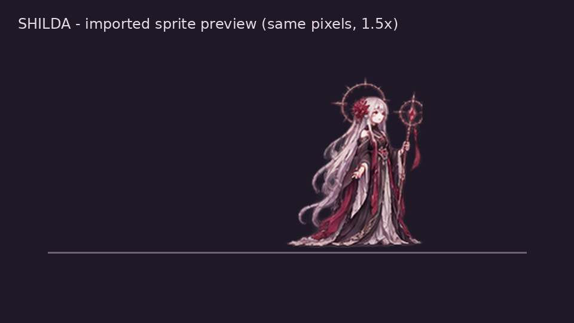
</p>

#### Shilda Duygu Portreleri Matrisi (`assets/portraits/shilda/`)
| `neutral` | `gentle` | `smile` | `sad` | `worried` | `angry` | `determined` | `eyes_closed` |
| :---: | :---: | :---: | :---: | :---: | :---: | :---: | :---: |
|  |  |  |  |  |  |  |  |

<p align="center">
  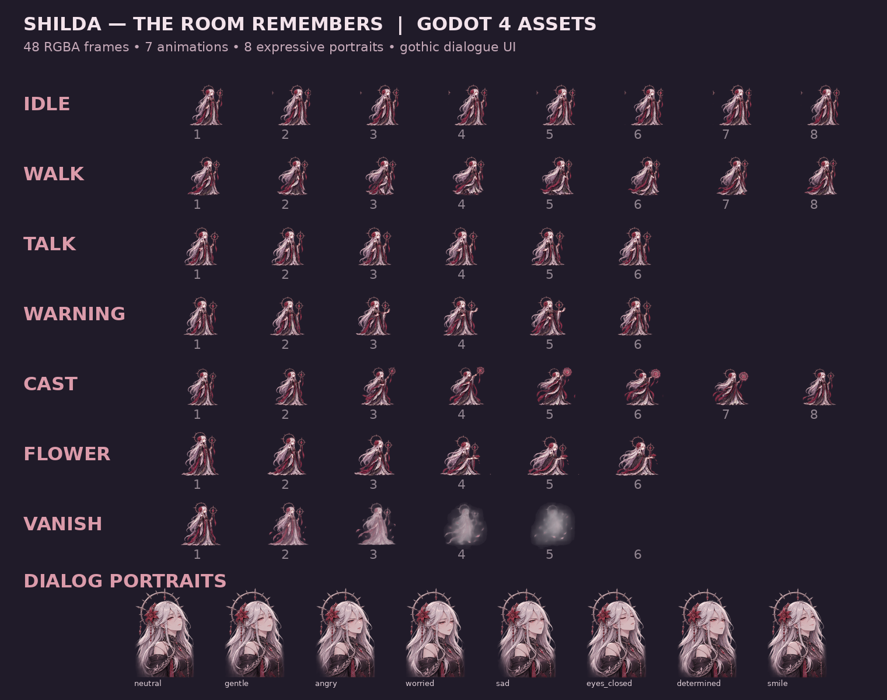
</p>

---

## 🕯️ Karakterler, Semboller ve Etkileşim Unsurları

| Görsel | Unsur | Rolü ve Mekanik İşlevi |
| :---: | :--- | :--- |
|  | **Noroi**<br/>*(Oyuncu)* | Her ölümde belleği sıfırlanan fakat dünyada bıraktığı izlerle gerçeğe yürüyen denek. 3'lü kılıç kombosu, **Gölge Atılması (`ShadowDash`)** ve **Ruh Kesimi (`SoulSlash`)** yeteneklerini kullanır. |
|  | **Shilda — Bekçi**<br/>*(The Keeper)* | Odanın hafızasını koruyan figür. Bedenlerinin başında yas tutar, çiçek bırakır. Ona saldırmak ya da güvenmek oyunun sonunu doğrudan belirler. |
|  | **Önceki Bedenler**<br/>*(Corpse & Echo)* | Öldüğün noktada kalan fiziksel bedenin. İlk incelemede son 3 saniyelik **Yankı Tekrarını** oynatır; sonrasında **itilebilir ağırlık**, **üzerine çıkılabilir platform** ve **lanet süngeri** olur. |
|  | **Kızıl Ölüm Çiçeği**<br/>*(Mourning Flower)* | Shilda'nın yas tuttuğu bedenlere bıraktığı çiçek. Çiçekli bedenler (**Fener Ceset**) karanlık odaları aydınlatır ve duvarlardaki gizli sembolleri görünür kılar. |
| 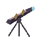 | **Teleskop & Dış Boşluk**<br/>*(Void Observation)* | Balkondaki antik aygıt. Tesisin gerçek dünyadan kopuk, yıldızsız ve donmuş karanlık bir boşlukta asılı olduğunu ortaya koyar. |
| 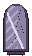 | **Çatlak Bellek Aynası**<br/>*(Cracked Mirror)* | Bölgeler arası tek kanonik hızlı seyahat ağı. Keşfedilen tapınaklar arasında hafıza sıçraması sağlar. |

---

## 📸 Ekran Görüntüleri Galerisi

<p align="center">
  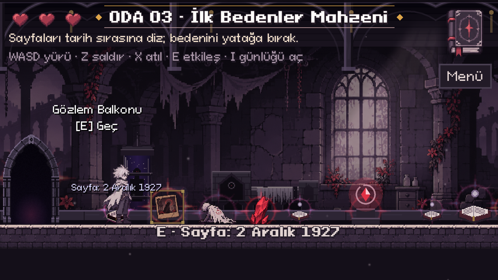
  &nbsp;
  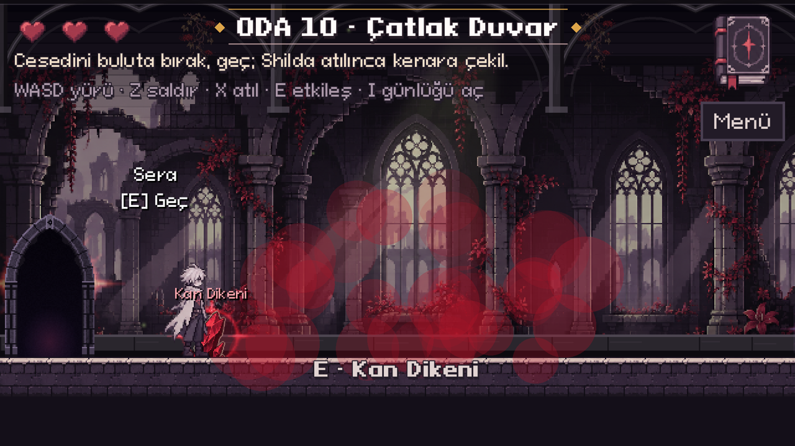
  <br/><sub>Oda 03 · İlk Bedenler Mahzeni &nbsp;·&nbsp; Oda 10 · Çatlak Duvar ve lanet bulutu</sub>
</p>
<p align="center">
  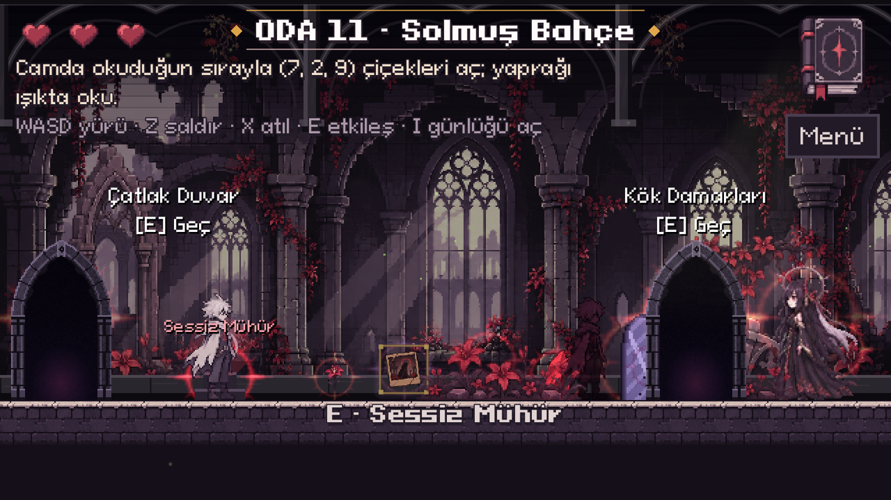
  &nbsp;
  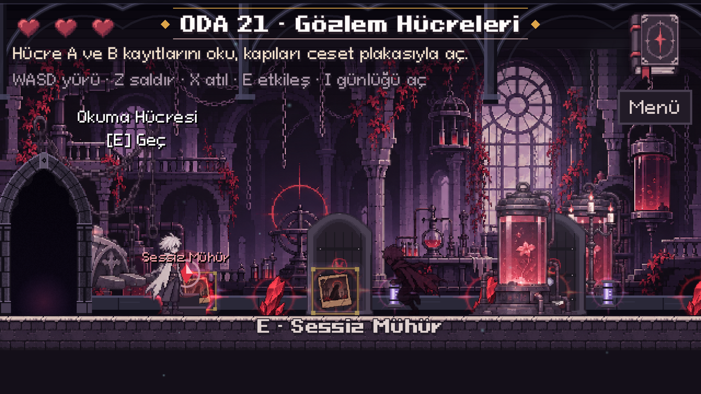
  <br/><sub>Oda 11 · Solmuş Bahçe &nbsp;·&nbsp; Oda 21 · Gözlem Hücreleri</sub>
</p>
<p align="center">
  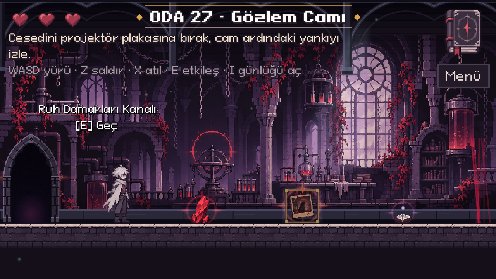
  &nbsp;
  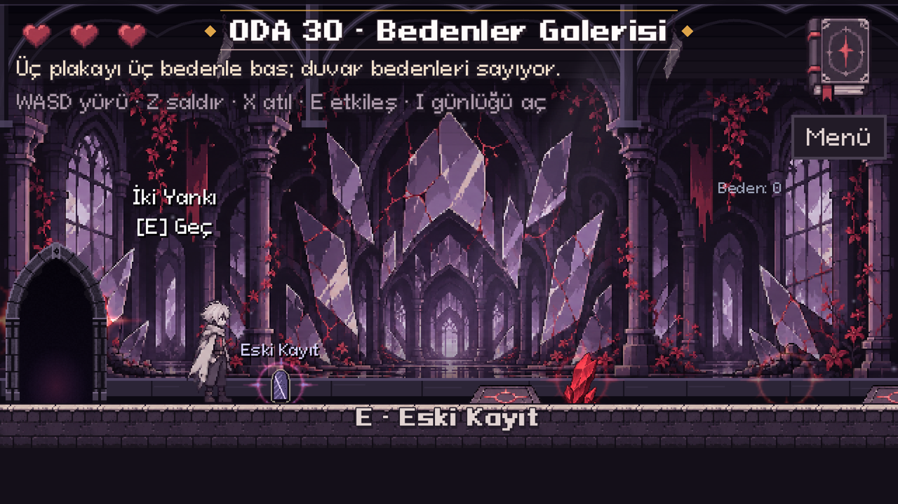
  <br/><sub>Oda 27 · Gözlem Camı &nbsp;·&nbsp; Oda 30 · Bedenler Galerisi</sub>
</p>
<p align="center">
  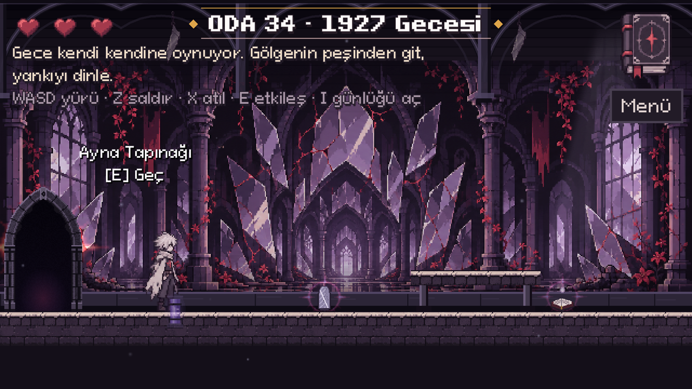
  <br/><sub>Oda 34 · 1927 Gecesi</sub>
</p>

---

## 📦 Aktif Sürümler ve İndirme Bağlantıları (GitHub Releases)

Depodaki tüm derlenmiş Android (`arm64-v8a`) APK paketleri düzenli olarak **[GitHub Releases](https://github.com/jagwey/THE-ROOM-REMEMBERS-release/releases)** sayfasında sunulmaktadır:

| Sürüm | Durum | APK Dosyası / İndirme | Öne Çıkan Yenilikler ve Kapsam |
| :--- | :---: | :--- | :--- |
| **[v1.20.1](https://github.com/jagwey/THE-ROOM-REMEMBERS-release/releases/tag/v1.20.1)** | Son yayın | [📥 `TheRoomRemembers-1.20.1-android-arm64.apk`](https://github.com/jagwey/THE-ROOM-REMEMBERS-release/releases/download/v1.20.1/TheRoomRemembers-1.20.1-android-arm64.apk) | Ruh toplama savaşı kesmez, ölümde düşman saldırısı sıfırlanır, uçtan uca savaş testi (`versionCode 62`). |
| **[v1.20.0](https://github.com/jagwey/THE-ROOM-REMEMBERS-release/releases/tag/v1.20.0)** | Önceki | [📥 `TheRoomRemembers-1.20.0-android-arm64.apk`](https://github.com/jagwey/THE-ROOM-REMEMBERS-release/releases/download/v1.20.0/TheRoomRemembers-1.20.0-android-arm64.apk) | Parçalanmış Ruhlar: saldıran ruh düşmanları (kalp eksiltir), 9 ruh toplama, Shilda final hükmü (`versionCode 61`). |
| **[v1.19.5](https://github.com/jagwey/THE-ROOM-REMEMBERS-release/releases/tag/v1.19.5)** | Önceki | [📥 `TheRoomRemembers-1.19.5-android-arm64.apk`](https://github.com/jagwey/THE-ROOM-REMEMBERS-release/releases/download/v1.19.5/TheRoomRemembers-1.19.5-android-arm64.apk) | Sera kapısı oyun içinde açılır, lanet ölümde sıfırlanır, lanetli yürüyüş normal (`versionCode 60`). |
| **[v1.19.4](https://github.com/jagwey/THE-ROOM-REMEMBERS-release/releases/tag/v1.19.4)** | Önceki | [📥 `TheRoomRemembers-1.19.4-android-arm64.apk`](https://github.com/jagwey/THE-ROOM-REMEMBERS-release/releases/download/v1.19.4/TheRoomRemembers-1.19.4-android-arm64.apk) | Sera kapısı düzeltildi, dokunmatik kontroller yeniden yerleşti (`versionCode 59`). |
| **[v1.19.0](https://github.com/jagwey/THE-ROOM-REMEMBERS-release/releases/tag/v1.19.0)** | Önceki | [📥 `TheRoomRemembers-1.19.0-android-arm64.apk`](https://github.com/jagwey/THE-ROOM-REMEMBERS-release/releases/download/v1.19.0/TheRoomRemembers-1.19.0-android-arm64.apk) | Okunabilirlik ve softlock turu: Sera'da saksıya yürüyen gölge, diken iniş işareti, Mezar Dehlizi yeniden yerleşimi, gölge bulmacaları ve ipuçları netleşti (`versionCode 55`). |
| **[v1.18.6](https://github.com/jagwey/THE-ROOM-REMEMBERS-release/releases/tag/v1.18.6)** | Önceki | [📥 `TheRoomRemembers-1.18.6-android-arm64.apk`](https://github.com/jagwey/THE-ROOM-REMEMBERS-release/releases/download/v1.18.6/TheRoomRemembers-1.18.6-android-arm64.apk) | Günlük Türkçe metin cilası, dokunmatik ilk adım rehberi, buton boyutu ve titreşim ayarı, ortam anları, mobil yerleşim ve kararlılık düzeltmeleri (`versionCode 54`). |
| **[v1.18.5](https://github.com/jagwey/THE-ROOM-REMEMBERS-release/releases/tag/v1.18.5)** | Önceki | [📥 `TheRoomRemembers-1.18.5-android-arm64.apk`](https://github.com/jagwey/THE-ROOM-REMEMBERS-release/releases/download/v1.18.5/TheRoomRemembers-1.18.5-android-arm64.apk) | Günlük/harita sekmesinde üst üste binen yazılar düzeltildi (`versionCode 53`). |

---

## 🎮 Kontroller

| Eylem | Masaüstü (Klavye) | Android (Dokunmatik HUD) |
| :--- | :--- | :--- |
| **Hareket** | `A / D`, `Sol / Sağ Ok` | Sol Sanal Joystick (Sabit veya Yüzen mod) |
| **Zıplama** | `W`, `Space`, `Yukarı Ok` | Sağ HUD — **Zıpla (`^`)** *(Coyote + Değişken Yükseklik)* |
| **Saldırı (3'lü Kombo)** | `Z` veya `J` | Sağ Alt — **Kılıç** Butonu |
| **Atılma / Gölge Atılması** | `X` veya `K` | Sağ Alt — **Dash** Butonu |
| **Etkileşim / İtme / Konuşma** | `E` veya `F` | Sağ Orta — **El (`Interact`)** Butonu |
| **Yetenek (Ruh Kesimi)** | `C` veya `L` | Sağ HUD — **Ruh Kesimi (`Skill`)** Butonu |
| **Günlük & Harita** | `I` veya `Tab` | Sağ Üst — **Günlük (Kitap)** İkonu |
| **Duraklatma & Ayarlar** | `Esc` | Sağ Üst — **Menü** Butonu / Android Sistem Geri Tuşu |

---

## 🚀 Kurulum, Çalıştırma ve Test Altyapısı

### 1. Android Cihaza Kurulum (APK)
1. **[Releases](https://github.com/jagwey/THE-ROOM-REMEMBERS-release/releases)** sayfasından son sürüm `.apk` dosyasını indirin.
2. Veya USB hata ayıklaması açık cihaza `adb` ile yükleyin:
   ```powershell
   adb install -r TheRoomRemembers-1.18.6-android-arm64.apk
   adb shell am start -n com.torimon.theroomremembers/com.godot.game.GodotApp
   ```

### 2. Godot Editöründe Çalıştırma (Geliştirici)
1. **[Godot Engine 4.7.2](https://godotengine.org/download)** konsol veya standart sürümünü indirin.
2. Depoyu açın ve `project.godot` dosyasını projeye yükleyin:
   ```bash
   git clone https://github.com/jagwey/THE-ROOM-REMEMBERS.git
   cd THE-ROOM-REMEMBERS
   ```
3. Ana sahne `scenes/main/main.tscn` olarak ayarlıdır; **F5** ile doğrudan başlatabilirsiniz.

### 3. Otomatik Headless QA ve Audit Testleri (`scripts/dev/`)
Projeyi kod tabanı seviyesinde doğrulayan 50'den fazla otonom test betiği bulunur:

```powershell
$godot = "C:\Users\Osman\OneDrive\Desktop\Godot_v4.7.2-stable_win64.exe\Godot_v4.7.2-stable_win64_console.exe"
$env:TORIMON_TEST = "1"

# 1. Master E2E Doğrulama (Tier 1-4, 50 kontrol)
& $godot --headless --path . -s res://scripts/dev/e2e_runner.gd

# 2. 47 Oda ve Kapı Grafiği Bütünlüğü Denetimi
& $godot --headless --path . -s res://scripts/dev/release_audit.gd

# 3. Ölüm, Rebirth ve Kalıcı Dünya Denetimi
& $godot --headless --path . -s res://scripts/dev/death_loop_audit.gd

# 4. Lanet ve Mühür Tapınakları Denetimi
& $godot --headless --path . -s res://scripts/dev/memory_seal_audit.gd
```

**v1.18.6 için zorunlu denetimler (hepsi 0 FAIL).** Her biri `TORIMON_TEST=1 godot --headless --path . -s res://scripts/dev/<ad>.gd` ile çalışır:

| Konu | Denetimler |
| :--- | :--- |
| Kanon ve metin | `lore_canon_audit`, `dialogue_lint_audit`, `dialogue_data_audit`, `story_fill_audit` |
| Bulmaca ve ipuçları | `clue_solvability_audit`, `phase2_rooms_audit`, `phase3_rooms_audit`, `phase4_rooms_audit` |
| Oda grafiği ve kapılar | `room_graph_audit`, `door_audit`, `room_header_fit_audit`, `fast_travel_audit` |
| Yeni içerik | `deep_rooms_audit`, `weak_rooms_audit`, `backtrack_nooks_audit`, `echo_trials_audit`, `memory_fragments_audit`, `room_polish_audit` |
| Ayar, kayıt, yayın | `settings_audit` (buton boyutu, titreşim seviyesi + taşıma), `save_quit_audit`, `save_robustness_audit`, `release_audit` |
| Geri bildirim | `feedback_audit` (ceset toast'ı, oynama süresi, düzenek sıfırlama notu, günlük rozeti, ortam anı, hızlı seyahat ipucu) |
| Eski milestone | `m1_challenger1_audit`, `m1_challenger2_audit`, `m1_forensic_auditor_suite`, `m1_rebirth_audit`, `m1_stress_challenger2`, `m2_seal_audit`, `m2_adversarial_forensic_suite`, `m2_challenger1_stress`, `m3_transition_audit` |
| Arayüz yerleşimi | `journal_layout_audit` (günlük/harita sekmelerinde üst üste binen yazı yok; 1280x720, 1920x1080, 2400x1080, büyük yazı) |
| Mobil yerleşim | `mobile_layout_audit` (dokunmatik düğmeler, HUD, diyalog ve seçim kutusu çakışmıyor; dokunma hedefi ≥44 px; ~80 px çentik payı; 8 telefon/tablet çözünürlüğü, normal ve büyük yazı), `controls_audit`, `door_controls_audit` |

Toplu çalıştırma için `docs/gelistirme/Run-Audit.ps1` kullanılır.

> **Sürüm hazırlık raporları:** `qa/release-readiness/` altında v1.12.2 için QA/Google Play hazırlık raporları (oda matrisi, hikâye denetimi, hata kaydı, Play kontrol listesi, GO/NO-GO) bulunur. Mevcut karar: NO-GO (cihaz/insan testi, AAB, imza ve politika eksikleri). Kanıtlar yalnız headless/statik; gerçek cihaz testi yapılmadı. Çalışma kopyasında (commit edilmemiş) kayıt sağlamlığı, kilitlenme korumaları ve kanon metin düzeltmeleri yapıldı; yeni denetimler `softlock_reset_audit.gd` ve `save_robustness_audit.gd`, hepsi `docs/gelistirme/Run-Audit.ps1` içinde. Play yayını için taslaklar `docs/play/` altında (kontrol listesi, gizlilik taslağı, lisans listesi, mağaza metni). Play sürümünde güncelleme düğmesini kapatmak için export ön ayarına `play_store` özel özelliği eklenmelidir (`UpdateChecker.is_disabled_build()`). Kanon kararları (otonom, geri alınabilir): 1995 yalnız Perde 3+ içinde okunur; `shilda_past_discovered` Yetki Masası itirafında set edilir; `lore_canon_audit` CANON-A/B bunları korur. O raporda ana yol ~43 dk idi; v1.18.4 itibarıyla ana yol ~65 dk, tam oyun ~190 dk. Mağaza görselleri taslağı `docs/play/store/` altındadır (öne çıkan görsel 1024×500 + aday ekran görüntüleri; yakalama aracı `scripts/dev/room_visual_capture.gd`).

---

## 📜 Geliştirici & Ajan Kuralları

Projeye katkı veren her yapay zekâ ajanı, alt ajan veya geliştirici aşağıdaki kurallara **kesinlikle** uyar:
1. **GÖREV SONU DOKÜMANTASYON KURALI (ZORUNLU):** Her ajan / alt ajan bir işi, revizyonu veya görevi bitirdiğinde; yapılan tüm değişiklikleri, yeni mekanikleri, mimari detayları ve sürüm bilgisini MUTLAKA `README.md` ve `PROGRESS.md` dosyalarına yansıtacaktır. Dokümantasyon asla bayat bırakılamaz.
2. **Kanonik Dil Standardı:** Kod tanımlayıcıları İngilizce (`snake_case` fonksiyonlar, `PascalCase` sınıflar), oyun içi metinler ve diyaloglar mutlaka **Türkçe (UTF-8)** olmalıdır.
3. **Kalıcı Dünya İlkeleri:** Ölüm durumunda dünya ilerlemesi (açılan kapılar, çözülen bulmacalar, kırılan duvarlar) asla sıfırlanmaz.
4. **Tek Kanonik Final:** Hikâye Part I için tek bir kanonik son içerir (`BÖLÜM I SONU`). Eski alternatif son dalları geçersizdir.

---
<p align="center">
  <sub>TORIMON STUDIO · THE ROOM REMEMBERS · 2026</sub>
</p>
